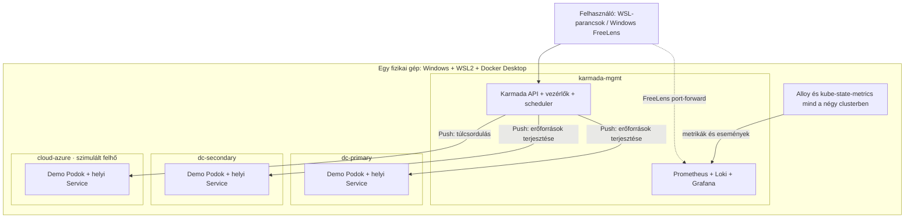
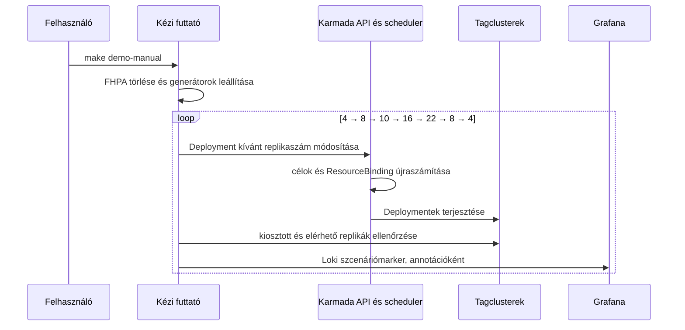
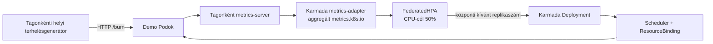
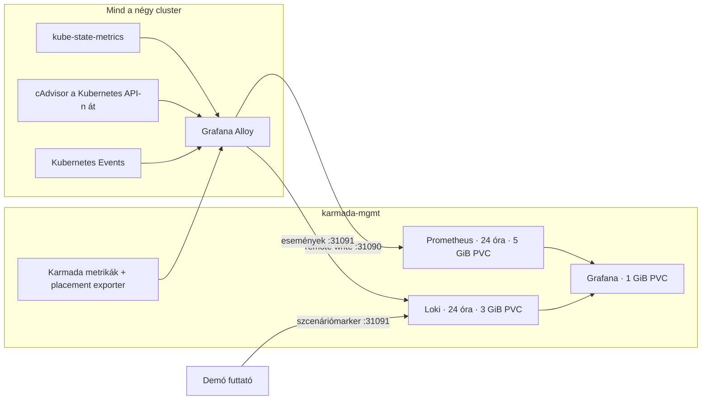
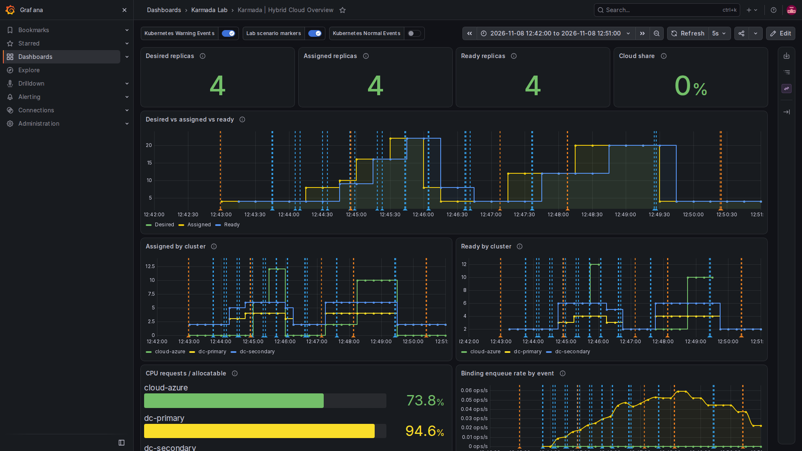
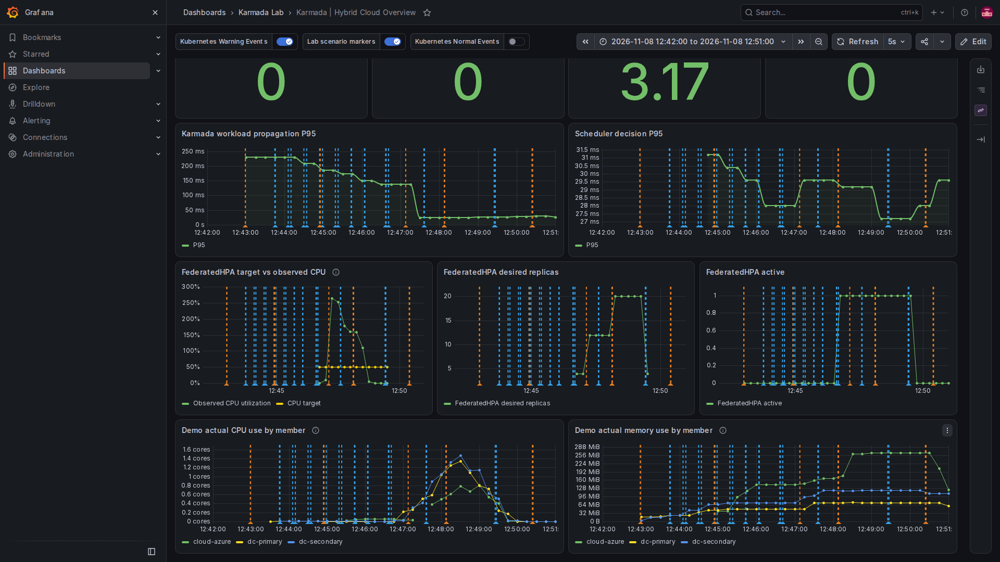
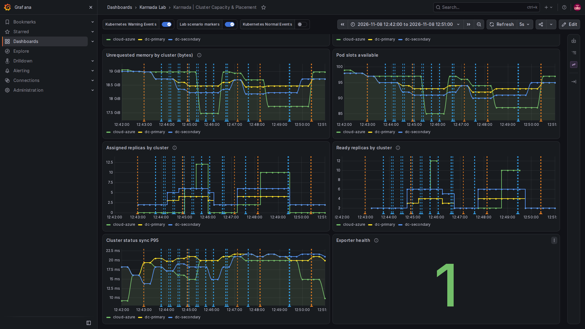

# A Karmada-labor működése és architektúrája

[English](ARCHITECTURE.md) | **Magyar**

Ez a leírás azoknak szól, akik szeretnék megérteni, **mi történik a laborban**, amikor egy alkalmazás replikaszáma változik. A gyors indításhoz lásd a [README-t](../README.hu.md). Az ábrák a labor jelenlegi konfigurációját szemléltetik, nem egy általános vagy éles üzemi architektúrát.

## 1. Mit modellez a labor?

Egy szolgáltatás elsődlegesen két helyszíni Kubernetes-clusterben fut. Ha a kívánt replikák az elérhetőként becsült helyszíni kapacitásba nem férnek bele, a Karmada egy harmadik, felhőt szimuláló clusterbe is helyez replikákat. Három kérdést vizsgálunk:

1. **Kézi változtatás:** mi történik az elhelyezéssel, ha mi növeljük, majd csökkentjük a replikaszámot?
2. **Automatikus változtatás:** mi történik, ha a replikaszámot egy CPU-metrika alapján a FederatedHPA módosítja?
3. **Clusterkiesés:** átkerülnek-e a replikák az egészséges tagokra, szükség esetén a cloudba, ha a `dc-primary` elérhetetlenné válik?

Mind a négy cluster egy helyi gép WSL2/Docker Desktop környezetében, külön kind clusterként fut. A `cloud-azure` neve szerepet jelöl: **nem valódi Azure**, és az ábrák nem internetes vagy több fizikai gépet érintő kapcsolatot mutatnak.



A tagclustereket a Karmada **Push** módban kezeli: a management oldali vezérlők a tagok Kubernetes API-ján keresztül juttatják el hozzájuk az erőforrásokat. A Grafana megfigyelésre szolgál, nem ő ütemezi az alkalmazást.

## 2. A részek feladata

| Összetevő | Feladat és hatása |
| --- | --- |
| Karmada API és adattár | Itt él az alkalmazás központi sablonja, a policy és a FederatedHPA. Ez külön API a `karmada-mgmt` Kubernetes API-jától. |
| Karmada controller-manager | Figyeli a központi erőforrásokat és policykat, kezeli a terjesztési folyamatot és a tagclusterek állapotát. |
| Karmada scheduler | A policy, a tagok állapota és a becsült kapacitás alapján meghatározza a célclustereket és az oda osztott replikákat. |
| ResourceBinding és Work | A ResourceBinding összeköti a központi erőforrást a kiválasztott célokkal és a replikakiosztással; a Work a célclusterre küldendő erőforrásokat képviseli. |
| Tagcluster Kubernetes-vezérlők | A tagba jutott Deploymentből ReplicaSetet és Podokat hoznak létre; a helyi Kubernetes scheduler node-ra ütemezi a Podokat. |
| `metrics-server` | Mindhárom tagban összegyűjti a helyi Kubernetes resource metrikákat; ezek az autoskálázási út részei. |
| `karmada-metrics-adapter` | A tagok resource metrikáit a Karmada aggregált `metrics.k8s.io` API-ján elérhetővé teszi. A FederatedHPA ezt használja. |
| FederatedHPA | A megfigyelt CPU-kihasználtság és a cél alapján módosítja a központi Deployment kívánt replikaszámát az előírt határok között. Csak az automatikus demó alatt létezik. |
| Alloy és kube-state-metrics | Az Alloy mind a négy clusterből gyűjt és továbbít; a kube-state-metrics a Kubernetes-objektumok állapotáról szolgáltat metrikákat. |
| Placement exporter | A Karmada API-t olvassa: többek között a kívánt és a ResourceBindingben kiosztott replikákat, valamint a FederatedHPA állapotát teszi Prometheus-metrikává. |
| Prometheus, Loki, Grafana | A Prometheus metrikákat, a Loki eseményeket és markereket tárol; a Grafana ezeket jeleníti meg. |
| Capacity-reservation Pod | Alacsony tényleges terhelésű Pod, amely CPU-requestet foglal, hogy a laborban jól megfigyelhető legyen a túlcsordulás. |

## 3. A döntéstől a futó Podig

```mermaid
flowchart LR
    D["Központi Deployment<br/>kívánt replikák"] --> POLICY["PropagationPolicy<br/>cél és elosztás"]
    POLICY --> SCHED["Karmada scheduler<br/>kapacitásbecslés + döntés"]
    SCHED --> RB["ResourceBinding<br/>kiosztás tagonként"]
    RB --> WORK["Work + Push terjesztés"]
    WORK --> MEMBER["Tagclusterek: Deployment"]
    MEMBER --> POD["Helyi Kubernetes:<br/>ReplicaSet és Podok"]
    POD --> READY["Elérhető replikák visszajelzése"]
```



Például 22 kívánt replikánál a legutóbbi tesztben a binding 4-et osztott a `dc-primary`, 6-ot a `dc-secondary` és 12-t a `cloud-azure` részére. Ez önmagában még csak **kiosztás**: külön ellenőriztük, hogy a tagok Deploymentjei ugyanennyi elérhető replikát jelentettek. A dashboardon a `Ready` felirat a tagi Deploymentek `availableReplicas` értékéből származik; az áttekinthetőség kedvéért használja a Ready megnevezést.

### A két policy és a workload

A működő beállítások forrásai a [Deployment](../karmada/placement-demo.yaml), a [burst policy](../karmada/overflow-policy.yaml), a [Service](../karmada/service.yaml) és a [Service policy](../karmada/service-propagation.yaml).

| Beállítás | Mit jelent itt? | Miért számít? |
| --- | --- | --- |
| `resourceSelectors` | A burst policy a `demo/placement-demo` Deploymentet választja ki. | Más workloadra nem ez a megadott szabály vonatkozik. |
| `clusterAffinities` | Az `on-prem` csoport: `dc-primary`, `dc-secondary`. | Először ezt a csoportot vizsgálja a scheduler. |
| `overflowAffinities` | A következő, `public-cloud` csoport: `cloud-azure`. | A felhős cél túlcsordulásra szolgál. |
| `replicaSchedulingType: Divided` | A kívánt replikákat a kiválasztott tagok között osztja szét. | A teljes kívánt szám nem minden clusterben ismétlődik meg. |
| `replicaDivisionPreference: Weighted`, `dynamicWeight: AvailableReplicas` | A súlyt a scheduler által becsült elérhető replikakapacitás befolyásolja. | A két on-prem tag között nem garantált 50–50% elosztás. |
| `propagateDeps: true` | A policy függőségek terjesztését is kéri. | A labor Service-ének önálló policyja van, így annak célzására nem ebből következtetünk. |
| Külön Service policy | A `placement-demo` Service mindhárom tagba megy. | A helyi terhelésgenerátor minden tagban a saját `ClusterIP` Service-ét használja; cloud Pod nélkül ott eleinte nincs helyi endpoint. |
| Pod request: `250m` CPU, `128Mi` memória | Egy demo Pod ütemezési igénye; a memórialimit `256Mi`. | A request a kapacitásszámítás és a CPU-utilizáció viszonyítási alapja. |

A labor schedulerében a `CustomizedClusterResourceModeling=false`: a konfiguráció az itt alkalmazott requestalapú kalibráláshoz a részletes cluster-erőforrásösszesítést használja. Az első korábbi tesztnél az alapértelmezett, durvább modell a névleg még elférő on-prem replikákat idő előtt cloudba irányította; a jelenlegi beállítás mellett a teljes kézi sor sikeres volt. Ez a laborbeli megfigyelés nem általános teljesítményígéret. A beállítást a [scheduler konfigurálója](../scripts/configure-scheduler.py) alkalmazza.

### Miért éppen 4 + 6 + 12?

A [kapacitáskalibráló](../scripts/calibrate-capacity.py) minden egynode-os tagban megnézi az allocatable erőforrásokat és a már igényelt requesteket. Ezután a `capacity-reservation` Pod requestjét úgy számítja, hogy hozzávetőleg 4, 6, illetve 12 darab, egyenként 250m CPU-requestű demo Pod férjen el, 150m CPU-puffer mellett. Ellenőrzi a memóriarequesteket, a Pod-helyeket, valamint a WSL szabad memóriáját, és megvárja a Karmada cluster-erőforrásösszesítésének közelítését.

Az **allocatable mínusz requestek** ütemezési adat; nem az éppen szabad processzoridő vagy fizikai memória. A három kind node ugyanazt a WSL-gépet használja, ezért a clusterekben látható szabad memóriaértékek nem adhatók össze fizikai kapacitásként. A foglaló Pod CPU-requestje sem jelent állandó, ugyanekkora tényleges CPU-fogyasztást.

## 4. A szcenárió: kézi skálázás



A `make demo-manual` minden lépésnél megvárja, hogy a központi kívánt szám, a binding-kiosztás és a tagok Deploymentjeinek elérhető replikaszáma összhangba kerüljön. Alapértelmezésben ezután 20 másodpercig vár; állítható például `STAGE_SECONDS=60 make demo-manual` paranccsal. A lépések pillanatképei a privát `.runtime/manual/` mappába kerülnek.

| Kívánt szám | A legutóbbi újraépítés utáni megfigyelés: `dc-primary` + `dc-secondary` + `cloud-azure` |
| --- | --- |
| 4 | 2 + 2 + 0 |
| 8 | 3 + 5 + 0 |
| 10 | 4 + 6 + 0 |
| 16 | 4 + 6 + 6 |
| 22 | 4 + 6 + 12 |
| 8 | 3 + 5 + 0 |
| 4 | 2 + 2 + 0 |

Ezek egy tényleges futás eredményei, nem minden helyzetre garantált eloszlások. A kézi teszt 4, 8 és 10 esetén cloud nélküli elhelyezést, 16 és 22 esetén cloud-túlcsordulást vár; visszaskálázáskor az eredményt megfigyeli. A felhős replikák jelen futásban eltűntek, de a labor nem ígér általános automatikus visszaköltöztetést minden későbbi kapacitásváltozásnál.

## 5. B szcenárió: FederatedHPA és CPU-terhelés



Az [FHPA-beállítás](../karmada/federated-hpa.yaml) a `placement-demo` Deploymentre vonatkozik:

| Beállítás | Hatás |
| --- | --- |
| `minReplicas: 4`, `maxReplicas: 22` | Az autoskálázó kívánt replikaszáma a megadott határok közé esik. |
| `averageUtilization: 50` | Az átlagos CPU-használat célja a CPU-request 50%-a. Egy 250m requestű Podnál a 125m CPU 50%-os viszonyítási érték; a jelentett kihasználtság 100% fölé is mehet. |
| `scaleUp.stabilizationWindowSeconds: 0` | A konfiguráció nem ad felfelé külön stabilizációs ablakot. |
| `scaleUp.policies: Pods`, `value: 8`, `periodSeconds: 60` | A skálázási viselkedés részeként egy 60 másodperces időszakhoz nyolc Podos növekedési policy tartozik. |
| `scaleDown.stabilizationWindowSeconds: 60` | Visszaskálázásnál a vezérlő 60 másodperces stabilizációs ablakot használ. |

A `make demo-auto` előbb ellenőrzi a resource metrics útját és alaphelyzetbe állít. Utána létrehozza a FederatedHPA-t, minden tagban elindít egy helyi load generatort, és figyeli a CPU-t, a HPA-t, a bindingot és a tagi Ready értékeket. A generátorok alapból két workerrel indulnak; ha 90 másodperc után még nem sikerült burstöt elérni, négyre emelhetik. Egy generátor CPU-limitje 250m. A generátor a **helyi** Service-en keresztül a `/burn?ms=120` végpontot hívja; ahol nincs helyi endpoint, ott a hívások átmenetileg sikertelenek lehetnek.

A sikeres burst ellenőrzése több feltételből áll: az észlelt CPU 50% fölött van, a HPA 10 fölötti számot kíván, van cloud-kiosztás és cloud Ready replika, és a Karmada aggregált Pod-metrikái között megjelenik a `cloud-azure`. Ezután a futtató leállítja a generátorokat, megvárja a négy Ready replikát, törli az FHPA-t és alapállapotba állít. A két szakasz időkorlátja alapból 600–600 másodperc; hiba esetén a script megpróbál visszaállítani. WSL-oldali CPU- és memóriahatárok is felügyelik a futást, a Windows teljes gazdagépének külön mérése nem része a jelenlegi labornak.

A legutóbbi újraépített környezetben 265%-os CPU-értéknél a kívánt szám 12-re nőtt, és a Ready megoszlás 4+6+2 lett. A terhelés leállítása után korábbi minták miatt a kívánt szám átmenetileg 20-ra is nőtt, majd a rendszer négyre csökkent. Az FHPA célja és a teljes WSL CPU-ja tehát más mérőszám; a késleltetés sem garantáltan ugyanilyen minden futásban. A minták `.runtime/auto/` alatt találhatók.

## 6. Megfigyelés: honnan jönnek a grafikonok?



A metrikák és az események központja a `karmada-mgmt`; a tagokban nincs külön Prometheus vagy Loki. Az Alloy a Kubernetes Events adatokat Loki-ba, a metrikákat Prometheus remote-write-on továbbítja. A management Alloy a scheduler, controller-manager és placement exporter metrikáit is gyűjti. A cAdvisor az adott Kubernetes API-n keresztül, hitelesítve érhető el. A demófuttató külön strukturált markereket küld Loki-ba.

A tag Podok a management kind node Docker-hálózaton elérhető címét használják a 31090/31091 NodePortokhoz; a saját `127.0.0.1` címük nem a management clustert jelenti. A Windows/WSL oldali fix portok: a négy Kubernetes API 16443–16446, a Karmada API 16447 → node 32443; a Prometheus/Loki fogadók 31090 és 31091. A Grafana felülete FreeLens-port-forwarddal érhető el, ingress nélkül. A PVC-k a kind node helyi tárolóján vannak; a cluster törlésekor elvesznek.

### Hogyan olvasd a Grafanát?

A képek a 2026. november 8-i, újraépítés utáni tényleges futásból származnak; az időtengely a böngésző helyi idejét mutatja. Pillanatfelvételek: az aktuális eredmény más lehet, a Prometheus/Loki megőrzési ideje 24 óra. Az annotációvonalra mutatva látható a hozzá tartozó szöveg; a warning és a demómarkerek alapértelmezetten be vannak kapcsolva, a `verify` markerek a képernyőről szűrve vannak.



**Karmada | Hybrid Cloud Overview:**

- A felső `Desired replicas`, `Assigned replicas`, `Ready replicas` és `Cloud share` panelek az időtartomány végéhez tartozó állapotot mutatják; a példakép végén 4/4/4 és 0% cloud látható.
- A `Desired vs assigned vs ready` az időbeli változást mutatja. Az egymástól ideiglenesen eltérő vonalak megmutatják a scheduler/terjesztés/Pod-indulás késleltetését. Az első csúcs a kézi 22, a későbbi az automatikus futás.
- Az `Assigned by cluster` a Karmada döntését, a `Ready by cluster` a tagok elérhető Deployment-replikáit mutatja. A vonalak **nem halmozottak**: a zöld `cloud-azure`, sárga `dc-primary`, kék `dc-secondary` vonal magassága az adott tag önálló értéke.
- `Unassigned replicas` a kívánt és kiosztott, az `Assigned but not ready` a kiosztott és elérhető replikaszám különbsége. Átmenetileg a normál konvergencia során is lehetnek nem nullák.
- `CPU requests / allocatable` foglalási arány; nem az aktuális CPU-fogyasztás. A `Binding enqueue rate by event` események sorba kerülésének sebessége, nem a várólista hossza.



Az alsó áttekintő panelek a B szcenáriót magyarázzák. A `FederatedHPA target vs observed CPU` sárga vonala az 50%-os cél, a zöld a mért, requesthez viszonyított kihasználtság. A `FederatedHPA desired replicas` a vezérlő kívánt számát, a `FederatedHPA active` az objektum jelenlétét mutatja. Amíg nincs FHPA, az aktivitás 0, az FHPA CPU- és replikastátusz nem értelmezhető. A `Demo actual CPU use by member` és `Demo actual memory use by member` a demo konténerek tényleges használata; nem a teljes Windows-gépé. Az FHPA döntésének forrása a metrics-server/adapter út, nem a Prometheus-grafikon.



**Karmada | Cluster Capacity & Placement:** a `CPU request utilization %` és `Memory request utilization %` a requestek allocatable-hoz viszonyított aránya. Az `Unrequested CPU` és `Unrequested memory` az ütemezési szempontból nem kért kapacitást mutatja; az utóbbi nem a gép tényleges szabad memóriája. A `Pod slots available` külön korlát. Az `Exporter health` 1 értéke az exporter legutóbbi Karmada-lekérdezésének sikerét jelzi, nem minden más komponens egészségét.

**Karmada | Scheduler & Propagation:** a scheduler-kísérletek, a bindingok beérkezésének üteme és a terjesztés P95 késleltetése segít a hiba behatárolásában. A P95 egy adott időablak hisztogramalapú becslése, nem az egyes replikák pontos indulási ideje. A hibaesemény-sorozat `No data` is lehet, ha még nem keletkezett ilyen címkéjű sorozat; az adathiány önmagában sem a nulla hibát, sem a gyűjtés egészségét nem bizonyítja. A Karmada v1.19.1-ben a `scheduler_pending_bindings` gauge más regiszterbe kerül, mint amelyet a scheduler végpontja kiszolgál; ezért a várólista mélysége ezen a dashboardon nem áll rendelkezésre. A beérkezési ráta más mérőszám.

A külön [cluster-failover forgatókönyv](../scenarios/02-cluster-failover.hu.md) egy elérhetetlen tag és a túlélő on-prem kapacitás kimerülése után jelentkező cloud-túlcsordulás esetét vizsgálja. A kézi és HPA-demótól függetlenül implementáltuk.

## 7. Tipikus kérdések és ellenőrzések

| Jelenség | Mit nézz meg? |
| --- | --- |
| A `Desired` nagyobb az `Assigned` értéknél | Policy, Karmada Cluster Ready állapot és erőforrásösszesítés; van-e elegendő becsült ütemezési kapacitás? |
| Az `Assigned` nagyobb a `Ready` értéknél | A tag Deploymentje és Podjai: Pending, image-letöltés, readiness probe, helyi node-kapacitás és Kubernetes Events. |
| A cloud Service létezik, de eleinte nincs válasz | Normális lehet, amíg a cloudban nincs helyi demo Pod/endpoint; a helyi Service nem másik clusterbe irányít. |
| Az FHPA-panel üres vagy a cél nem látszik | Létezik-e éppen az FHPA, és lefedi-e az időtartomány az automatikus demót? Alapállapotban az FHPA-t eltávolítjuk. |
| A cloud nem ürül ki rögtön | A skálázás és a terjesztés késleltetett; a stabilizációs ablak és a minták is számítanak. Az automatikus újraelhelyezés nem minden helyzetben garantált. |
| FreeLens 503 újraépítés után | Új kubeconfig és új tanúsítvány keletkezett. A README FreeLens-része leírja az új importot és a forrásfájlok visszaállítását. |

Hasznos diagnosztikai parancsok:

```bash
kubectl --kubeconfig .runtime/karmada/karmada-apiserver.config get clusters
kubectl --kubeconfig .runtime/karmada/karmada-apiserver.config -n demo get deployment,resourcebinding,federatedhpa
kubectl --context kind-dc-primary -n demo get deployment,pods
kubectl --context kind-dc-secondary -n demo get deployment,pods
kubectl --context kind-cloud-azure -n demo get deployment,pods
make verify
```

A `make verify` az ellenőrzéshez eseményeket és egy markert hoz létre. Részletes ellenőrzési és mérési eredmények: [VALIDATION_RESULTS.md](VALIDATION_RESULTS.md); parancsok és célzott PromQL: [runbook](../scenarios/01-06-burst-runbook.md).

### További hivatkozások

- [Karmada: FederatedHPA működése](https://karmada.io/docs/userguide/autoscaling/federatedhpa/) és [erőforrás-metrikás autoskálázási útmutató](https://karmada.io/docs/tutorials/autoscaling-with-resource-metrics/).
- [Karmada: erőforrások terjesztése és replikák elosztása](https://karmada.io/docs/v1.14/userguide/scheduling/resource-propagating/) — általános háttér; a labor ténylegesen rögzített verziója és policyja az itt bemutatott v1.19.1.
- [Grafana Alloy dokumentáció](https://grafana.com/docs/alloy/latest/) és a projekt [megfigyelési beállításai](../observability/README.md).
