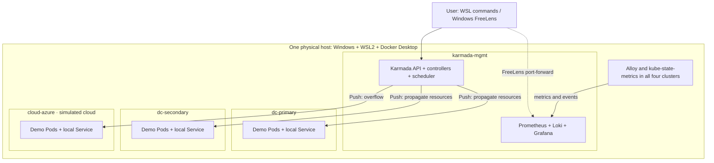
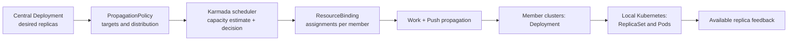
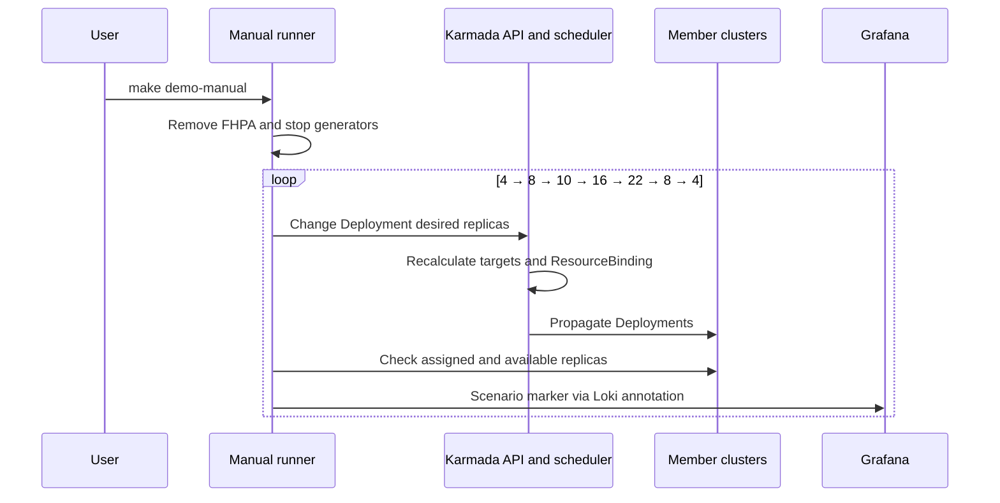
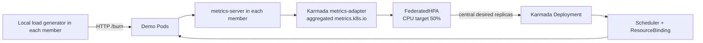
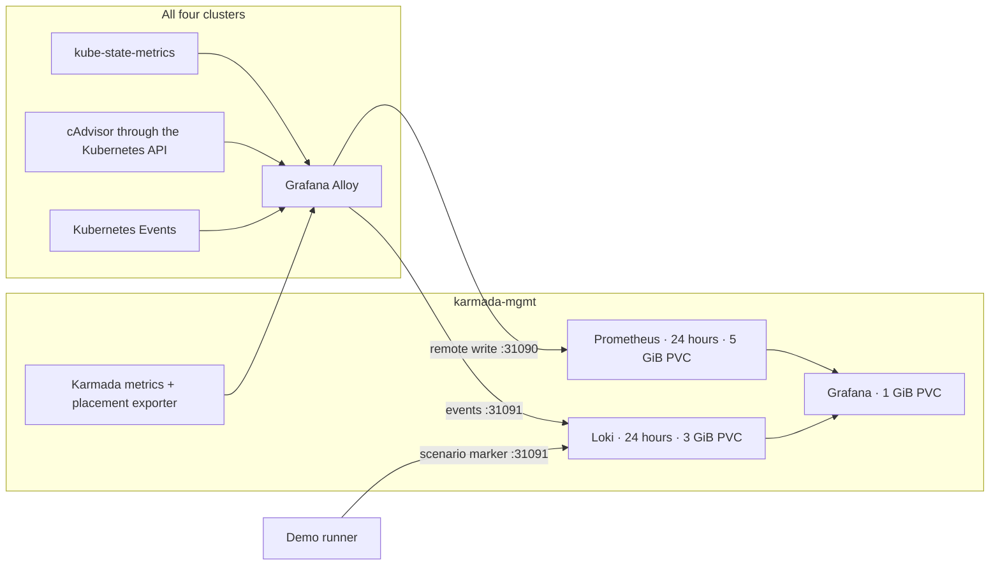
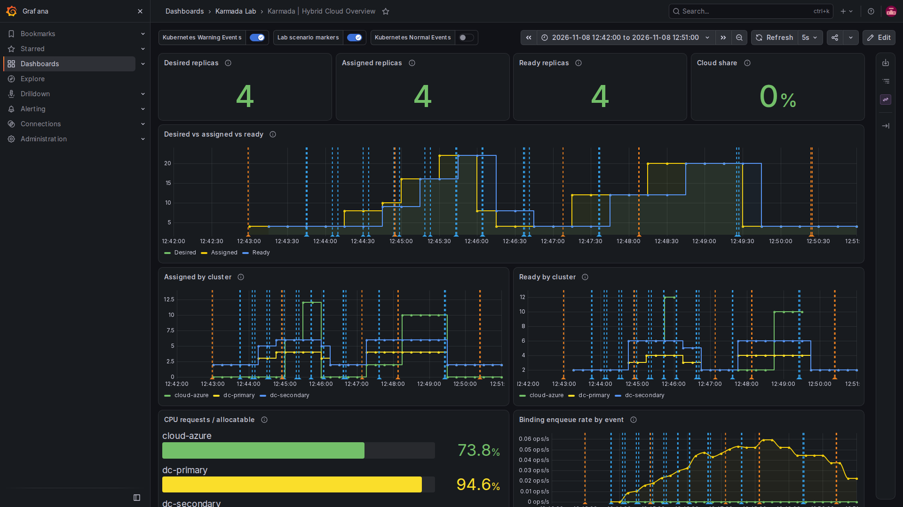
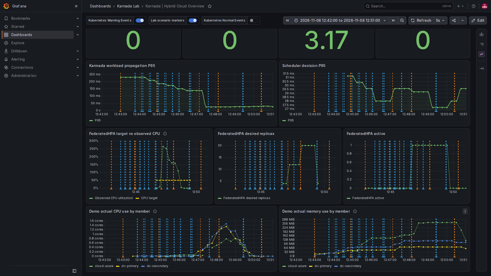
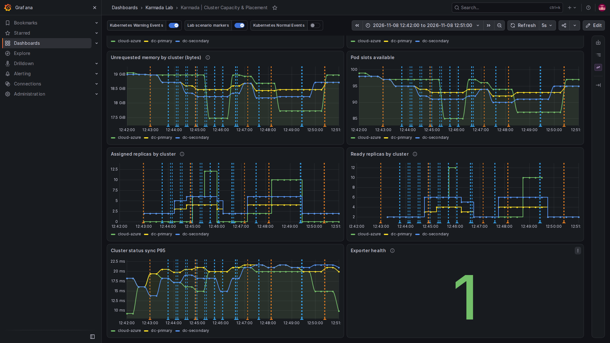

# How the Karmada Lab Works: Architecture and Scenarios

**English** | [Magyar](ARCHITECTURE.hu.md)

This guide explains **what happens in the lab** when an application's replica count changes. For a quick start, see the [README](../README.md). The diagrams describe this lab's configuration, not a generic or production architecture.

## 1. What does the lab model?

A service primarily runs in two on-premises Kubernetes clusters. When the desired replicas no longer fit within their estimated available capacity, Karmada also places replicas in a third cluster that simulates the cloud. We investigate two questions:

1. **Manual change:** what happens to placement when we increase and then decrease the replica count ourselves?
2. **Automatic change:** what happens when FederatedHPA changes the replica count in response to a CPU metric?

All four clusters run as separate kind clusters on one local WSL2/Docker Desktop host. The name `cloud-azure` denotes a role: it is **not actual Azure**. The diagrams do not represent an internet connection or multiple physical hosts.



Karmada manages the member clusters in **Push** mode: controllers on the management side send resources through each member's Kubernetes API. Grafana is for observation; it does not schedule the application.

## 2. What does each component do?

| Component | Role and effect |
| --- | --- |
| Karmada API and data store | Hold the central application template, policy and FederatedHPA. This API is separate from the Kubernetes API of `karmada-mgmt`. |
| Karmada controller-manager | Watches central resources and policies, manages propagation and tracks member-cluster state. |
| Karmada scheduler | Chooses target clusters and replica assignments using the policy, member state and estimated capacity. |
| ResourceBinding and Work | A ResourceBinding associates the central resource with selected targets and replica assignments; a Work represents resources to be sent to a target cluster. |
| Member Kubernetes controllers | Create ReplicaSets and Pods from the propagated Deployment; the local Kubernetes scheduler places Pods on nodes. |
| `metrics-server` | Collects local Kubernetes resource metrics in each of the three members; it is part of the autoscaling path. |
| `karmada-metrics-adapter` | Exposes member resource metrics through Karmada's aggregated `metrics.k8s.io` API, which FederatedHPA uses. |
| FederatedHPA | Adjusts the central Deployment's desired count within the configured bounds based on observed CPU utilization and its target. It exists only during the automatic demo. |
| Alloy and kube-state-metrics | Alloy collects and forwards data from all four clusters; kube-state-metrics exposes Kubernetes object-state metrics. |
| Placement exporter | Reads the Karmada API and exposes metrics including desired replicas, ResourceBinding assignments and FederatedHPA state. |
| Prometheus, Loki, Grafana | Prometheus stores metrics, Loki stores events and markers, and Grafana displays them. |
| Capacity-reservation Pod | A Pod with low actual usage that reserves CPU requests so overflow is easy to observe in the lab. |

## 3. From a scheduling decision to running Pods



For example, at 22 desired replicas in the latest test, the binding assigned 4 to `dc-primary`, 6 to `dc-secondary` and 12 to `cloud-azure`. This alone is an **assignment**: we also checked that the member Deployments reported the same number of available replicas. The dashboard uses the label `Ready` for the member Deployments' `availableReplicas` values.

### The two policies and the workload

The actual settings are in the [Deployment](../karmada/placement-demo.yaml), [burst policy](../karmada/overflow-policy.yaml), [Service](../karmada/service.yaml) and [Service policy](../karmada/service-propagation.yaml).

| Setting | Meaning here | Why it matters |
| --- | --- | --- |
| `resourceSelectors` | The burst policy selects the `demo/placement-demo` Deployment. | This particular rule does not select other workloads. |
| `clusterAffinities` | The `on-prem` group contains `dc-primary` and `dc-secondary`. | The scheduler considers this group first. |
| `overflowAffinities` | The next group, `public-cloud`, contains `cloud-azure`. | The cloud target is used for overflow. |
| `replicaSchedulingType: Divided` | The desired replicas are divided among selected members. | The full desired count is not duplicated in every cluster. |
| `replicaDivisionPreference: Weighted`, `dynamicWeight: AvailableReplicas` | Weights depend on the scheduler's estimate of available replica capacity. | A 50–50 split between the two on-premises members is not guaranteed. |
| `propagateDeps: true` | The policy also requests propagation of dependencies. | The lab's Service has its own policy, so its targets are not inferred from this setting. |
| Separate Service policy | The `placement-demo` Service goes to all three members. | Each load generator uses its own local `ClusterIP` Service; without a cloud Pod, the cloud Service initially has no local endpoint. |
| Pod request: `250m` CPU, `128Mi` memory | One demo Pod's scheduling request; its memory limit is `256Mi`. | The request is the basis for capacity estimates and CPU utilization. |

The lab scheduler sets `CustomizedClusterResourceModeling=false`, using the detailed cluster resource summary for this request-based calibration. In an earlier first test, the default, coarser model sent replicas to the cloud early even though nominal on-premises slots remained; with the current setting, the complete manual sequence passed. This lab observation is not a general performance guarantee. The [scheduler configuration script](../scripts/configure-scheduler.py) applies the setting.

### Why 4 + 6 + 12?

The [capacity calibrator](../scripts/calibrate-capacity.py) inspects allocatable resources and existing requests in each single-node member. It then calculates the `capacity-reservation` Pod request to leave room for approximately 4, 6 and 12 demo Pods respectively, each requesting 250m CPU, plus a 150m CPU buffer. It checks memory requests, Pod slots and available WSL memory, and waits for the Karmada cluster resource summary to converge.

**Allocatable minus requests** is a scheduling measure, not currently idle CPU time or available physical memory. The three kind nodes share one WSL host, so their reported unrequested memory must not be added as independent physical capacity. The reservation Pod's CPU request also does not imply constant actual CPU consumption of that amount.

## 4. Scenario A: manual scaling



At every stage, `make demo-manual` waits for the central desired count, binding assignments and member Deployment available counts to agree. It then waits 20 seconds by default; adjust this with, for example, `STAGE_SECONDS=60 make demo-manual`. Stage snapshots are written to the private `.runtime/manual/` directory.

| Desired | Observed after the latest rebuild: `dc-primary` + `dc-secondary` + `cloud-azure` |
| --- | --- |
| 4 | 2 + 2 + 0 |
| 8 | 3 + 5 + 0 |
| 10 | 4 + 6 + 0 |
| 16 | 4 + 6 + 6 |
| 22 | 4 + 6 + 12 |
| 8 | 3 + 5 + 0 |
| 4 | 2 + 2 + 0 |

These are results from a real run, not a guaranteed distribution in every situation. The manual test expects no cloud assignment at 4, 8 and 10 and cloud overflow at 16 and 22; it observes placement on scale-in. Cloud replicas disappeared in this run, but the lab does not promise automatic move-back for every later capacity change.

## 5. Scenario B: FederatedHPA and CPU load



The [FHPA configuration](../karmada/federated-hpa.yaml) targets the `placement-demo` Deployment:

| Setting | Effect |
| --- | --- |
| `minReplicas: 4`, `maxReplicas: 22` | The autoscaler's desired count stays within these bounds. |
| `averageUtilization: 50` | Target average CPU usage is 50% of the CPU request. For a Pod requesting 250m, 125m CPU is the 50% reference; reported utilization can exceed 100%. |
| `scaleUp.stabilizationWindowSeconds: 0` | The configuration adds no separate scale-up stabilization window. |
| `scaleUp.policies: Pods`, `value: 8`, `periodSeconds: 60` | The scaling behavior includes an eight-Pod growth policy over a 60-second period. |
| `scaleDown.stabilizationWindowSeconds: 60` | The controller uses a 60-second stabilization window when scaling down. |

`make demo-auto` first verifies the resource-metrics path and resets the baseline. It creates the FederatedHPA, starts one local load generator in each member, and observes CPU, HPA, binding and member Ready values. Generators start with two workers; if burst has not been reached after 90 seconds, the runner can increase them to four. Each generator has a 250m CPU limit. A generator calls `/burn?ms=120` through its **local** Service; calls can temporarily fail where no local endpoint exists.

A successful burst requires several conditions: observed CPU above 50%, HPA desired count above 10, a cloud assignment and a Ready cloud replica, and `cloud-azure` in Karmada's aggregated Pod metrics. The runner then stops the generators, waits for four Ready replicas, removes the FHPA and resets the baseline. The default timeout is 600 seconds for each phase; on failure the script attempts a reset. WSL-side CPU and memory guardrails monitor the run; separate measurement of the entire Windows host is not part of the current lab.

In the latest rebuilt environment, at 265% CPU the desired count rose to 12 and the Ready distribution reached 4+6+2. After load stopped, earlier samples briefly drove the desired count to 20 before the system scaled back to four. The FHPA target and total WSL CPU are different measurements, and timing is not guaranteed across runs. Samples are stored under `.runtime/auto/`.

## 6. Observability: where do the graphs come from?



Metrics and events are centralized in `karmada-mgmt`; there is no separate Prometheus or Loki in the members. Alloy forwards Kubernetes Events to Loki and metrics through Prometheus remote write. Management Alloy also scrapes scheduler, controller-manager and placement-exporter metrics. cAdvisor is accessed through the relevant Kubernetes API with authentication. The demo runner sends separate structured markers to Loki.

Member Pods use the management kind node's Docker-network address for the 31090/31091 NodePorts; their own `127.0.0.1` is not the management cluster. Fixed Windows/WSL ports are 16443–16446 for the four Kubernetes APIs, Karmada API 16447 → node 32443, and 31090/31091 for the Prometheus/Loki receivers. Grafana is accessed using a FreeLens port-forward, without ingress. The PVCs use kind node-local storage and are lost when the cluster is deleted.

### How to read Grafana

The screenshots show actual runs after the rebuild on November 8, 2026; the time axis uses the browser's local time. They are snapshots: current results may differ, and Prometheus/Loki retention is 24 hours. Hover over an annotation line to see its text. Warning events and demo markers are enabled by default; `verify` markers are filtered from the display.



**Karmada | Hybrid Cloud Overview:**

- The top `Desired replicas`, `Assigned replicas`, `Ready replicas` and `Cloud share` panels show state at the end of the selected time range; the example ends at 4/4/4 and 0% cloud.
- `Desired vs assigned vs ready` shows changes over time. Temporarily different lines expose scheduler, propagation and Pod-startup delays. The first peak is the manual run at 22, and the later one is the automatic run.
- `Assigned by cluster` shows Karmada's decision; `Ready by cluster` shows the members' available Deployment replicas. Lines are **not stacked**: green is `cloud-azure`, yellow is `dc-primary`, and blue is `dc-secondary`; each line's height is that member's own value.
- `Unassigned replicas` is the difference between desired and assigned; `Assigned but not ready` is the difference between assigned and available. Either can temporarily be nonzero during normal convergence.
- `CPU requests / allocatable` is a reservation ratio, not current CPU consumption. `Binding enqueue rate by event` is the rate of events entering scheduler queues, not queue depth.



The lower overview panels explain scenario B. In `FederatedHPA target vs observed CPU`, yellow is the 50% target and green is measured utilization relative to requests. `FederatedHPA desired replicas` shows the controller's desired count; `FederatedHPA active` shows whether the object exists. When no FHPA exists, activity is 0 and its CPU and replica status have no meaningful value. `Demo actual CPU use by member` and `Demo actual memory use by member` show actual demo-container usage, not usage of the whole Windows host. The FHPA makes decisions from the metrics-server/adapter path, not from the Prometheus chart.



**Karmada | Cluster Capacity & Placement:** `CPU request utilization %` and `Memory request utilization %` are request-to-allocatable ratios. `Unrequested CPU` and `Unrequested memory` show capacity not requested for scheduling; the latter is not the host's actual free memory. `Pod slots available` is a separate constraint. An `Exporter health` value of 1 means the exporter's most recent Karmada poll succeeded; it does not establish the health of every other component.

**Karmada | Scheduler & Propagation:** scheduler attempts, binding enqueue rate and P95 propagation latency help narrow down problems. P95 is a histogram-based estimate over a time window, not the exact startup time of individual replicas. An error series may show `No data` when no series with that label has yet been created; missing data alone establishes neither zero errors nor healthy collection. In Karmada v1.19.1, the `scheduler_pending_bindings` gauge is registered in a different registry from the one served by the scheduler endpoint, so queue depth is unavailable on this dashboard. Enqueue rate is a different measurement.

## 7. Common questions and checks

| Symptom | What to inspect |
| --- | --- |
| `Desired` exceeds `Assigned` | Policy, Karmada Cluster Ready state and resource summary: is there sufficient estimated scheduling capacity? |
| `Assigned` exceeds `Ready` | Member Deployments and Pods: Pending state, image pulls, readiness probes, local node capacity and Kubernetes Events. |
| The cloud Service exists but does not initially respond | This can be normal until a local cloud demo Pod/endpoint exists; the local Service does not route to a different cluster. |
| The FHPA panel is empty or the target is missing | Does the FHPA currently exist, and does the selected time range include the automatic demo? The FHPA is removed at baseline. |
| Cloud replicas do not disappear immediately | Scaling and propagation take time; stabilization and samples also matter. Automatic relocation is not guaranteed in every situation. |
| FreeLens returns 503 after a rebuild | New kubeconfigs and certificates were generated. The README's FreeLens section describes reimport and recovery of source files. |

Useful diagnostic commands:

```bash
kubectl --kubeconfig .runtime/karmada/karmada-apiserver.config get clusters
kubectl --kubeconfig .runtime/karmada/karmada-apiserver.config -n demo get deployment,resourcebinding,federatedhpa
kubectl --context kind-dc-primary -n demo get deployment,pods
kubectl --context kind-dc-secondary -n demo get deployment,pods
kubectl --context kind-cloud-azure -n demo get deployment,pods
make verify
```

`make verify` creates Events and a marker for verification. Detailed checks and measured results: [VALIDATION_RESULTS.md](VALIDATION_RESULTS.md); commands and targeted PromQL: [runbook](../scenarios/01-06-burst-runbook.md).

### Further references

- [Karmada: how FederatedHPA works](https://karmada.io/docs/userguide/autoscaling/federatedhpa/) and the [resource-metrics autoscaling tutorial](https://karmada.io/docs/tutorials/autoscaling-with-resource-metrics/).
- [Karmada: resource propagation and replica distribution](https://karmada.io/docs/v1.14/userguide/scheduling/resource-propagating/) — general background; the lab's actual pinned version and policy are the v1.19.1 configuration described here.
- [Grafana Alloy documentation](https://grafana.com/docs/alloy/latest/) and the project's [observability configuration](../observability/README.md).
