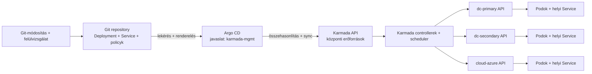

# Argo CD + Karmada: GitOps integrációs koncepció

[English](ARGOCD_KARMADA.md) | **Magyar**

**Állapot: koncepció, a laborban nincs telepítve és validálva.** A repository alapértelmezett nyelve az angol; a meglévő labort jelenleg továbbra is a `make` és scriptjei telepítik és működtetik. Az Argo CD hozzáadása architekturális változás, amelyhez külön döntés, rögzített verzió, implementáció és tényleges teszt szükséges. Ez a dokumentum nem hoz létre Argo CD-komponenst, Applicationt, hitelesítést vagy repositoryt.

## 1. Cél: ki mit csinál?

A kívánt eredmény: a demo Deploymentje, Service-e és Karmada policyjai Gitben legyenek, az Argo CD ezeket a **Karmada API-ba** alkalmazza, a Karmada pedig továbbra is elossza őket a tagclusterek között. Az Argo CD és a Karmada más-más feladatot végez:

| Összetevő | Felelősség a javasolt modellben |
| --- | --- |
| Git | Verziózott kívánt manifestek és véleményezési történet. Önmagában nem építi és nem futtatja az image-et. |
| Argo CD | Lekéri a kiválasztott Git-verziót, előállítja a manifesteket, összehasonlítja és szinkronizálja őket a beállított cél API-val. |
| Karmada | Figyeli a központi erőforrásokat és policykat, eldönti a célclustereket és a replikakiosztást, majd továbbítja az erőforrásokat. |
| Tagcluster Kubernetes | A hozzá eljuttatott Deploymenteket és Service-eket egyezteti és futtatja a tényleges Podokat. |
| CI / image-terjesztés | Megépíti az image-et és mindegyik tag számára elérhetővé teszi; az Argo CD önmagában nem image-build pipeline. |



A Karmada API **nem** a management cluster Kubernetes API-ja. Ha az Argo CD a `karmada-mgmt` clusterben fut, a szokásos in-cluster cél (`https://kubernetes.default.svc`) a management Kubernetes API-ra mutatna, nem a külön Karmada API-ra. Utóbbit külön Argo CD célként kell regisztrálni, saját címmel, bizalmi lánccal és hitelesítéssel.

## 2. Javasolt elhelyezés és kapcsolat

A laborban egyetlen, `karmada-mgmt` clusterben futó Argo CD-installáció lehetséges kialakítás; jelenleg ilyen nincs. Az Application controllernek a Karmada API-t **a saját Podjából** kell elérnie: a `.runtime/karmada/karmada-apiserver.config` fájlban szereplő, hostoldali `127.0.0.1:16447` erre nem használható. A jelenlegi placement exporter a management clusteren belül a `https://karmada-apiserver.karmada-system.svc:5443` címet használja; ez Argo CD számára jelölt végpont, de az Argo CD saját futási környezetéből az elérést, a TLS SAN/CA-t és a hitelesítést ellenőrizni kell.

A Karmada API-t Argo CD cluster-célként, az Argo CD namespace-ébe helyezett és `argocd.argoproj.io/secret-type: cluster` címkével ellátott Kubernetes Secrettel regisztrálhatjuk. A szerver URL-je és TLS-beállításai a Karmada API-t azonosítják; hitelesítéshez **külön Karmada-identitást** javasolt használni, a kiválasztott objektumokhoz, discoveryhoz és az Argo CD tényleges watch/list/sync működéséhez szükséges legszűkebb RBAC-kal. A pontos jogosultságokat ki kell dolgozni és tesztelni, nem szabad automatikusan a labor admin kubeconfigját átvenni vagy egy előre feltételezett minimális listát késznek tekinteni. Az Argo CD beállításától függően a cluster-szintű discovery és a Namespace létrehozása külön jogosultságot igényelhet. Az Argo CD AppProject korlátozza az engedélyezett repositoryt, célt, namespace-eket és erőforrástípusokat.

A Karmada-kliens identitása és a management Kubernetes-identitás különbözik: egy management Kubernetesben létrehozott ServiceAccount nem kap automatikusan jogosultságot a Karmada API-ban. A hitelesítő adatokat Giten kívül kell előállítani és rotálni; token, privát kulcs és `.runtime` kubeconfig nem kerülhet a repositoryba. Az API tanúsítványát a megfelelő CA-val ellenőrizni kell. A Secret formátumát az [Argo CD deklaratív cluster-regisztrációs dokumentációja](https://argo-cd.readthedocs.io/en/stable/operator-manual/declarative-setup/#clusters) írja le. A labor újraépítése lecserélheti a Karmada tanúsítványait és érvénytelenítheti a hitelesítést; a cél regisztrációjához dokumentált frissítési/rotációs folyamat kell.

## 3. Repository-felépítés és szinkronizációs határ

Egy későbbi GitOps-felépítés például ilyen lehet; ezek szemléltető, **jelenleg nem létező útvonalak**:

```text
gitops/
  placement-demo/
    base/                 # Karmada Namespace, Deployment, Service és a két policy
    overlays/
      manual/             # FederatedHPA nélkül
      auto/               # kiválasztáskor kifejezetten tartalmazza az FHPA-t
```

A jelenlegi kiinduló manifestek: [`karmada/placement-demo.yaml`](../karmada/placement-demo.yaml), [`service.yaml`](../karmada/service.yaml), [`overflow-policy.yaml`](../karmada/overflow-policy.yaml), [`service-propagation.yaml`](../karmada/service-propagation.yaml) és [`federated-hpa.yaml`](../karmada/federated-hpa.yaml). **A jelenlegi teljes `karmada/` könyvtárra változatlanul nem szabad Argo CD Applicationt irányítani**: az FHPA-manifest is ott van, így egy könyvtárszinkron a kézi szcenárió alatt is létrehozhatná. Olyan kifejezett Kustomize/Helm/sima manifestforrást kell meghatározni, amely pontosan a kívánt erőforrásokat választja ki.

Szemléltető Application-szerkezet, a későbbi implementációban kitöltendő helyőrzőkkel:

```yaml
apiVersion: argoproj.io/v1alpha1
kind: Application
metadata:
  name: placement-demo
  namespace: argocd
spec:
  project: karmada-lab
  source:
    repoURL: <GIT_REPOSITORY_URL>
    targetRevision: <REVIEWED_REVISION>
    path: gitops/placement-demo/overlays/manual
  destination:
    name: karmada-apiserver
    namespace: demo
```

Ez **ebben a formában nem telepíthető**: az útvonalat, projektet, célregisztrációt és hitelesítést előbb létre kell hozni, a helyőrzőket ki kell tölteni. Kezdetben kifejezett, kézi sync és kikapcsolt prune javasolt; az automatikus sync, self-heal, prune és törlésterjesztés csak későbbi döntés legyen. A Karmada API `demo` Namespace-e és az egyes tagok `demo` Namespace-e eltérő objektum. A jelenlegi `make deploy` külön létrehozza a tagi namespace-eket; a GitOps-megoldásnak egyenértékű tagi előfeltételt vagy tesztelt Karmada namespace-terjesztést kell biztosítania. Az Argo célon beállított `CreateNamespace=true` önmagában nem bizonyítja, hogy mindegyik tagban létezik a namespace.

## 4. Egyeztetés és tulajdonjog: ne versenyezzenek a vezérlők

A jelenlegi központi Deployment `spec.replicas: 4` értéket tartalmaz. A kézi script ezt változtatja, az automatikus szcenárióban az FHPA módosítja, a failover-futtató pedig ezt és ideiglenesen a burst policy toleranciáit is módosítja. Ha közben az Argo CD self-heal is a Gitben szereplő értéket akarja visszaállítani, a szereplők ugyanazért a mezőért versenyezhetnek.

| Szcenárió | Javasolt tulajdonosi koncepció |
| --- | --- |
| Git által kezelt alapállapot | Az Argo CD kezeli a workload sablonját, a Service-t és policykat; a kezdeti replikaszám beállítását külön rögzíteni kell. |
| Kézi skálázás | A replikaszámot ideiglenesen a felhasználó vagy futtató kezeli; a GitOps-egyeztetés ne állítsa rögtön vissza. |
| FederatedHPA | Aktív állapotban az FHPA kezeli a központi Deployment replikaszámát; a kézi overlay ne tartalmazza az FHPA-t. |
| Failover-kísérlet | A futtató ideiglenesen módosítja a burst policyt és a controller/webhook beállításait; a GitOps-egyeztetés ezeket a teszt közben ne állítsa vissza. |

Egy lehetséges megoldás az Application-szintű, csak a `demo/placement-demo` Deployment `/spec/replicas` mezőjére szűkített `ignoreDifferences`, valamint a `syncOptions` alatti `RespectIgnoreDifferences=true`. A sima `ignoreDifferences` az összehasonlítást befolyásolja, de **önmagában nem akadályozza meg**, hogy egy sync a Gitben szereplő értéket alkalmazza. A respect opció meglévő objektumnál hatásos; első létrehozáskor, élő objektum nélkül a kívánt manifest változatlanul alkalmazódik. A választott apply-móddal, managed fieldekkel, autoskálázással és az adott Argo CD/Karmada verzióval való kölcsönhatást integrációs tesztben kell ellenőrizni. Lásd: [Argo CD sync options](https://argo-cd.readthedocs.io/en/stable/user-guide/sync-options/#respect-ignore-differences-configs).

```yaml
# Application spec részlet: szemléltető, nem teljes Application.
ignoreDifferences:
  - group: apps
    kind: Deployment
    namespace: demo
    name: placement-demo
    jsonPointers:
      - /spec/replicas
syncPolicy:
  syncOptions:
    - RespectIgnoreDifferences=true
```

Ez önmagában nem teljes konkurenciakezelés. Egyértelműen meg kell határozni, melyik szcenárióban melyik szereplő birtokolja a mezőt, meg kell akadályozni az egyidejű kézi és automatikus módosítást, és el kell dönteni, miként szüneteljen az automatikus sync/self-heal a failover policy átmeneti módosítása alatt. Nem célszerű minden policy-különbséget tartósan figyelmen kívül hagyni, mert az a valódi policyváltozásokat is elrejtené. A mostani `make deploy`, `make reset-demo`, `make demo-manual`, `make demo-auto` és `make demo-failover` közvetlenül módosít erőforrásokat; Argo CD tulajdonlása előtt együttélési szabály vagy módosítás szükséges.

## 5. Sorrend, image-elérhetőség és állapot

1. Először a négy kind clustert, Karmadát, tagregisztrációt és a szükséges metrikakomponenseket kell bootstrapelni. Argo CD nem tud elérhetetlen Karmada API-ra szinkronizálni, és a policyk/FHPA fogadásához előbb a Karmada CRD-knek is regisztrálva kell lenniük. A jelenlegi bootstrap imperatív scripteket használ; ezt a koncepció nem váltja ki.
2. A demo image-et minden tag számára elérhetővé kell tenni. A jelenlegi labor a `karmada-lab/placement-demo:0.1.0` image-et helyben építi, majd `kind load docker-image` segítségével tölti be; későbbi CI/registry esetén rögzített image-et kell választani és biztosítani, hogy minden tag le tudja húzni. Egy Gitben alkalmazott Deployment nem tölti be az image-et a kind node-ba.
3. Biztosítani kell a központi és tagi namespace-eket, és ellenőrizni a Karmada API kapcsolatát és jogosultságait. Ezután kifejezetten kiválasztott manifestekkel szinkronizálható a Deployment, Service és policy. Sorrendhez használhatók az Argo CD [sync fázisai és hullámai](https://argo-cd.readthedocs.io/en/stable/user-guide/sync-waves/) egy szinkronon belül; önmagukban nem bizonyítják a tagi Podok Ready állapotát, és nem oldják meg automatikusan a külön Applicationök közötti függőséget.
4. Mindkét szintet ellenőrizni kell: az Argo CD `Synced` állapota a saját összehasonlítása/szinkronja szerinti eredményt jelzi; **önmagában nem bizonyítja**, hogy a Karmada kiosztotta a replikákat vagy a tagi Podok elérhetők. Vizsgálandó a Karmada `ResourceBinding`, a tagi Deploymentek és tényleges Podok, valamint a Grafana/Loki bizonyíték. A Karmada egyedi erőforrásainak Argo CD egészségértékelését és esetleges testreszabását a választott verzióval külön ki kell próbálni.
5. Az automatikus szcenárióban az FHPA csak a metrikafüggőségek és az alapállapot egészséges állapota után legyen aktív. A failovernél külön dönteni kell az átmeneti flagek, teszttaintek, kézi pause és takarítás GitOps-kapcsolatáról. A kind node szüneteltetéséhez továbbra is a laborhost vagy külön engedélyezett futtató kell; ezt a Git és az Argo CD nem végzi el automatikusan.

## 6. Javasolt implementációs és elfogadási terv

1. Olyan rögzített Argo CD-verziót és telepítési módot kell választani, amely elfér a laborban; az új komponenshez jóváhagyás szükséges. Eldöntendő, hogy maga az Argo telepítése bootstrap-scriptekben marad vagy külön GitOps-bootstrapet kap.
2. Létre kell hozni egy dedikált Karmada API-identitást és korlátozott Argo CD AppProjectet, majd az Argo CD controller Podjából tesztelni a discoveryt, TLS-ellenőrzést, jogosultságokat és az egyeztetést. Dokumentálni kell a credential-rotációt és az újraépítés utáni helyreállítást.
3. Titkok nélküli, explicit base/manual/auto repository-felépítés szükséges. Az image-építés/terjesztés és tagi namespace-ek előállítása is legyen reprodukálható.
4. Rögzíteni kell a replikaszámok és ideiglenes failover-policy módosítások tulajdonosát; meglévő és új objektumokkal is ellenőrizni a kézi sync, opcionális self-heal és `RespectIgnoreDifferences` viselkedését. Az automatizmus előtt a törlés/prune viselkedését eldobható környezetben kell tesztelni.
5. Egy kontrollált Git-módosítást végig kell követni commit → Argo CD sync → Karmada binding → tagi Ready Podok láncon. Ezután külön tesztelendő a kézi skálázás, FHPA, failover és reset; igazolandó, hogy az Argo CD nem vonja vissza az aktív kísérletet, az eredeti állapot pedig visszaállítható.
6. A tényleges verziók, parancsok, erőforrásállapotok, képernyőképek és hibák kerüljenek a validációs naplóba. Tesztelni kell az elérhetetlen Git, nem elérhető Karmada API, credential-rotáció és takarítás esetét; amit nem futtattunk, igazolatlannak kell jelölni.

A jelenlegi működésre továbbra is a labor [architektúrája](ARCHITECTURE.hu.md), a [szcenáriófuttató](../scenarios/02-cluster-failover.hu.md) és a [validációs eredmények](VALIDATION_RESULTS.md) az irányadók. A koncepció nem telepít új rendszert.
