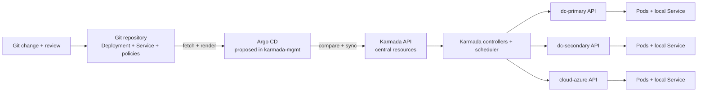

# Argo CD + Karmada: GitOps integration concept

**English** | [Magyar](ARGOCD_KARMADA.hu.md)

**Status: conceptual proposal, not installed or validated in this lab.** The repository defaults to English; the existing lab is still installed and operated by `make` and its scripts. Adding Argo CD is an architectural change and needs a separate decision, a pinned version, implementation and real tests. No Argo CD component, Application, credential or repository is created by this document.

## 1. Goal: who does what?

The desired outcome is to keep the demo Deployment, Service and Karmada policies in Git, have Argo CD apply them to the **Karmada API**, and let Karmada distribute them to member clusters. Argo CD and Karmada solve different parts of the problem:

| Component | Responsibility in the proposed model |
| --- | --- |
| Git | Versioned desired manifests and review history. It does not build or run the image on its own. |
| Argo CD | Fetches the chosen Git revision, renders manifests, compares and synchronizes them with the configured destination API. |
| Karmada | Watches its central resources and policies, decides the target clusters and replica assignment, and propagates resources. |
| Member Kubernetes clusters | Reconcile the propagated Deployments and Services and run the actual Pods. |
| CI / image distribution | Builds and makes the referenced image available to all members; Argo CD is not itself an image-building pipeline. |



The Karmada API is **not** the management cluster's Kubernetes API. If Argo CD runs in `karmada-mgmt`, configuring the normal in-cluster destination (`https://kubernetes.default.svc`) would target the management Kubernetes API, not Karmada's separate API. The latter must be registered as a separate Argo CD destination with its own address, trust and credentials.

## 2. Proposed placement and connection

For this lab, a single Argo CD installation in `karmada-mgmt` is a possible design; it is not present now. Its Application controller needs network access to the Karmada API from **inside its Pod**, not the host-only `127.0.0.1:16447` endpoint in `.runtime/karmada/karmada-apiserver.config`. The existing placement-exporter configuration uses `https://karmada-apiserver.karmada-system.svc:5443` inside the management cluster; it is a candidate endpoint for Argo CD, subject to direct connectivity, TLS SAN/CA and credential validation from Argo CD's own runtime.

Register the Karmada API as an Argo CD cluster destination using a Kubernetes Secret in Argo CD's namespace with `argocd.argoproj.io/secret-type: cluster`. Its server URL and TLS configuration identify the Karmada API; the credential should be a **dedicated Karmada identity** with the least RBAC required for the selected objects, discovery and Argo CD's actual watch/list/sync behavior. Determine and test the exact permissions rather than reusing the lab's administrator kubeconfig or assuming a fixed minimal list. Cluster-scoped discovery and Namespace creation can require separate permissions depending on the chosen Argo CD configuration. Restrict the Argo CD AppProject to the intended repository, destination, namespaces and resource kinds.

Karmada's client identity and the management Kubernetes identity are separate: a ServiceAccount created in management Kubernetes does not automatically grant rights in the Karmada API. Generate and rotate credentials outside Git, never put tokens, private keys or `.runtime` kubeconfigs in the repository, and validate the API certificate with the appropriate CA. Argo CD's [declarative cluster registration documentation](https://argo-cd.readthedocs.io/en/stable/operator-manual/declarative-setup/#clusters) describes the Secret format. Recreating the lab can replace Karmada certificates and invalidate credentials; the destination registration needs a documented refresh/rotation procedure.

## 3. Repository layout and sync boundary

A future GitOps layout could look like this; these paths are illustrative and **do not exist yet**:

```text
gitops/
  placement-demo/
    base/                 # Karmada Namespace, Deployment, Service and the two policies
    overlays/
      manual/             # no FederatedHPA
      auto/               # explicitly includes the FederatedHPA when selected
```

The starting manifests are currently [`karmada/placement-demo.yaml`](../karmada/placement-demo.yaml), [`service.yaml`](../karmada/service.yaml), [`overflow-policy.yaml`](../karmada/overflow-policy.yaml), [`service-propagation.yaml`](../karmada/service-propagation.yaml) and [`federated-hpa.yaml`](../karmada/federated-hpa.yaml). **Do not point an Argo CD Application at the entire current `karmada/` directory as-is**: it contains the FederatedHPA manifest as well, so a directory sync could create it during the manual scenario. Define an explicit Kustomize/Helm/plain-manifest source that selects exactly the desired resources.

Illustrative Application shape, with placeholders to fill only during a future implementation:

```yaml
apiVersion: argoproj.io/v1alpha1
kind: Application
metadata:
  name: placement-demo
  namespace: argocd
spec:
  project: karmada-lab
  source:
    repoURL: <GIT_REPOSITORY_URL>
    targetRevision: <REVIEWED_REVISION>
    path: gitops/placement-demo/overlays/manual
  destination:
    name: karmada-apiserver
    namespace: demo
```

This is **not deployable as written**: the path, project, destination registration and credentials must first exist and the placeholders must be replaced. Start with explicit, manual synchronization and pruning disabled; decide later whether automated sync, self-heal, prune and deletion propagation are appropriate. Namespace `demo` in the Karmada API and namespace `demo` in each member are different objects. The current `make deploy` explicitly creates the member namespaces; the GitOps design must provide and validate an equivalent member-namespace prerequisite or a tested Karmada namespace propagation mechanism. `CreateNamespace=true` for an Argo destination alone is not evidence that all member namespaces exist.

## 4. Reconciliation and ownership: avoid competing writers

The current source Deployment has `spec.replicas: 4`. The manual script changes that field, FederatedHPA changes it in the automatic scenario, and the failover runner temporarily changes it and patches the burst policy's tolerations. If Argo CD self-heal also insists on the Git value, these actors can fight over the same field.

| Scenario | Recommended ownership concept |
| --- | --- |
| Git-managed baseline | Argo CD owns the workload template, Service and policies; establish how the initial replica count is set. |
| Manual scaling | A person or runner temporarily owns the replica count; GitOps must be configured so reconciliation will not immediately restore it. |
| FederatedHPA | FederatedHPA owns the central Deployment's replica count while active; it should not exist in the manual overlay. |
| Failover experiment | The failover runner temporarily modifies the burst policy and controller/webhook settings; GitOps reconciliation must not revert those temporary changes mid-test. |

One candidate is an Application-level `ignoreDifferences` restricted to the `demo/placement-demo` Deployment's `/spec/replicas`, together with `RespectIgnoreDifferences=true` in `syncOptions`. Plain `ignoreDifferences` affects comparison but **does not by itself stop a sync from applying the Git value**. The respect option is effective for an existing object; on initial creation the desired manifest is still applied as-is. Its interaction with the selected apply mode, managed fields, autoscaling and the exact Argo CD/Karmada versions needs an integration test. See [Argo CD sync options](https://argo-cd.readthedocs.io/en/stable/user-guide/sync-options/#respect-ignore-differences-configs).

```yaml
# Partial Application spec: illustrative, not a complete Application.
ignoreDifferences:
  - group: apps
    kind: Deployment
    namespace: demo
    name: placement-demo
    jsonPointers:
      - /spec/replicas
syncPolicy:
  syncOptions:
    - RespectIgnoreDifferences=true
```

This is not a complete concurrency solution. Explicitly define which actor owns the field in each scenario, prevent simultaneous manual and automatic writers, and decide how to pause automated synchronization/self-heal for the failover policy patch. Do not permanently ignore all policy differences: doing so would also hide real policy changes. The current `make deploy`, `make reset-demo`, `make demo-manual`, `make demo-auto` and `make demo-failover` modify resources directly; they need an agreed coexistence protocol or adaptation before Argo CD takes ownership.

## 5. Ordering, image availability and status

1. Bootstrap the four kind clusters, Karmada, member registration and required metrics components first. Argo CD cannot sync to an unavailable Karmada API, and the Karmada CRDs must be registered before policies and FHPA can be accepted. The current bootstrap uses imperative scripts and is not replaced by GitOps in this proposal.
2. Make the demo image available to all members. The current lab builds `karmada-lab/placement-demo:0.1.0` locally and uses `kind load docker-image`; a future CI/registry model must select a pinned image and ensure every member can pull it. Applying a Deployment in Git does not load an image into kind.
3. Establish the central and member namespaces and validate connection and authorization to the Karmada API. Use an explicit manifest selection, then synchronize the Deployment, Service and policies. Where ordering is needed, Argo CD [sync phases and waves](https://argo-cd.readthedocs.io/en/stable/user-guide/sync-waves/) can order resources within a sync; they do not by themselves prove that member Pods are Ready or solve dependencies across independently synchronized Applications.
4. Check both layers: Argo CD `Synced` means its comparison/sync succeeded according to its configuration; it does **not** alone prove Karmada assigned replicas or that member Pods are available. Inspect Karmada `ResourceBinding`, each member Deployment and actual Pods, and the existing Grafana/Loki evidence. Karmada custom-resource health assessment and any Argo CD customization must be evaluated and tested for the selected version.
5. For the automatic scenario, enable the FHPA only after its metrics dependencies and baseline are healthy. For failover, decide explicitly how temporary flags, test taints, manual pause and cleanup interact with GitOps. A pause still requires the lab host or a separate authorized runner; Git and Argo CD do not automatically pause the kind node.

## 6. Suggested implementation and acceptance plan

1. Select and pin an Argo CD version and installation method that fit the lab's footprint; obtain approval for the additional component. Decide whether its own installation stays under bootstrap scripts or gets a separate GitOps bootstrap.
2. Create a dedicated Karmada API identity and constrained Argo CD AppProject, and test API discovery, TLS verification, authorization and reconciliation from the Argo CD controller Pod. Document credential rotation and recovery after cluster recreation.
3. Create a clean, explicit base/manual/auto repository layout without secrets. Make image build/distribution and member namespace provisioning reproducible.
4. Define ownership of replica counts and temporary failover policy changes; validate manual sync, optional self-heal and `RespectIgnoreDifferences` against existing and newly created resources. Test deletion/prune behavior in a disposable setup before enabling automation.
5. Run a controlled Git change through commit → Argo CD sync → Karmada binding → member Ready Pods. Then separately run manual scaling, FederatedHPA scaling, failover and reset; confirm Argo CD does not undo an active experiment and the original state can be restored.
6. Record exact versions, commands, resource states, screenshots and failures in the validation log. Test offline/unreachable Git, unavailable Karmada API, credential rotation and cleanup; mark anything not executed as unverified.

The existing lab's [architecture](ARCHITECTURE.md), [scenario runner](../scenarios/02-cluster-failover.md) and [validation results](VALIDATION_RESULTS.md) remain authoritative for current behavior. This concept adds no deployed system.
