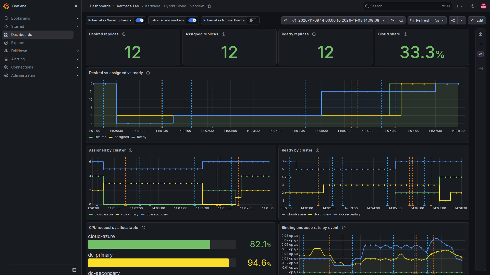

# C szcenárió – cluster-failover bemutatása

**Állapot: implementálva és a helyi laborban kipróbálva.** Az eredeti két demó önálló marad. A `make demo-failover` ideiglenesen módosítja a konfigurációt és kétszer szünetelteti a `dc-primary` clustert; végül megpróbálja visszaállítani az előző beállításokat és replikaszámot. A tényleges eredmények a validációs dokumentumban találhatók. [English](02-cluster-failover.md)

## Cél és kialakítás

Mutassuk meg, mi történik, ha a `dc-primary` elérhetetlenné válik, miközben az alkalmazásnak futnak rajta replikái. A hiba felismerését és a tényleges helyreállítást külön mérjük. Az elsődleges kísérletben a laborhoz tartozó `dc-primary-control-plane` konténert **valóban, ideiglenesen Docker pause-ba** tennénk. A kívánt replikaszám végig **8** lenne, FederatedHPA és terhelésgenerátor nélkül; így az esetleges pótlást a failover okozza, nem a változó replikacél.

A névleges kalibráció `dc-primary`/`dc-secondary`/`cloud-azure` sorrendben 4/6/12 hely. Egy korábbi, nyolcreplikás futás 3+5+0 eloszlást mutatott. Ha ez az eloszlás és a mért maradék kapacitás fennáll, a `dc-primary` három replikájának kiesése miatt a `cloud-azure`-re is szükség lehet. **Sem az induló 3+5+0, sem a végső eloszlás nem garantált**: a futás előtt a tényleges kiosztást és kapacitást kell ellenőrizni. Ha a `dc-secondary` mind a nyolcat fogadni tudja, a cloud nélküli helyreállás is lehet sikeres; az a futás viszont nem bizonyít cloud-túlcsordulást. Nem változtatjuk meg a kapacitást vagy a replikaszámot azért, hogy a teszt mesterségesen sikeresnek látszódjon.

```mermaid
sequenceDiagram
    participant U as Felhasználó / későbbi futtató
    participant P as dc-primary
    participant K as Karmada vezérlősík
    participant S as dc-secondary és cloud-azure
    participant G as Prometheus / Loki / Grafana
    U->>K: Alapállapot: 8 kívánt, kiosztott és Ready
    U->>P: Laborhoz tartozó kind node szüneteltetése
    P--xK: A tagcluster API-ja elérhetetlenné válik
    K->>K: Ready változik; NoSchedule, majd konfigurált NoExecute
    K->>K: Tolerancia lejár; kiürítés / újraütemezés
    K->>S: Pótló replikák terjesztése
    S-->>K: A tag Deploymentek elérhető replikákat jelentenek
    U->>G: Idővonal és markerek rögzítése
    U->>P: Folytatás csak ha ez a futás szüneteltette
    P-->>K: API és Ready helyreáll
    U->>K: Takarítás és megállapodott állapot ellenőrzése
```

Egy szüneteltetett folyamat nem bizonyítja, hogy az eredeti Podok megszűntek. A Karmada a pause ideje alatt nem feltétlenül tud a forrásclusterrel kommunikálni. A pótlás **új példány**; a régi példány a kapcsolat visszatérése után még létezhet. Ez a teszt nem igazolja a fencinget, az exactly-once működést, a megszakításmentes szolgáltatást, az éles üzemi megfelelést, az állandó adatok replikációját vagy a felhasználói forgalom átállását.

## Megállapítások a laborról és a Karmada v1.19.1-ről

A 2026. november 8-i olvasásos vizsgálatban mindhárom Karmada-tag `Ready` volt, cluster-taint nélkül; a `dc-primary` konténer futott és nem volt pause-ban. A demo **12 kívánt** replikán állt, 4+6+2 kiosztással, FederatedHPA nélkül. Ez pillanatfelvétel, nem a javasolt teszt alapállapota. A controller-manager deploymentben nem látszott külön failover-flag; a schedulerben szerepelt a `CustomizedClusterResourceModeling=false`. Ez még nem failoverteszt.

Az **automatikus**, valós pause-ra épülő teszthez a rögzített v1.19.1 forrásában három külön feltétel található:

1. A `Failover` alapértéke `false`; a `karmada-controller-manager` számára a `--feature-gates=Failover=true` bekapcsolása szükséges, a többi feature gate megőrzésével. A taint managernek is engedélyezve kell lennie; upstream alapértéke `true`, de a tényleges beállítást ellenőrizni kell.
2. A beépített állapotvezérlő `Ready=False` / `Unknown` esetén `NoSchedule` taintet kezel. A v1.14 óta **nem** teszi automatikusan hozzá a kiürítéshez szükséges `NoExecute` taintet. Egy külön `ClusterTaintPolicy` fordíthatja le az állapotot `NoExecute` taintre, majd távolíthatja el helyreálláskor. A teszt csak a **`dc-primary`** clustert célozza, az `Unknown` állapotot is lefedő `Ready NotIn True` hozzáadási és `Ready In True` eltávolítási feltétellel.
3. A `NoExecute`-ot tartalmazó `ClusterTaintPolicy` használatához `karmada-webhook --allow-no-execute-taint-policy=true` szükséges; a tényleges taintalapú kiürítéshez ezenfelül `karmada-controller-manager --enable-no-execute-taint-eviction=true` kell. Mindkettő alapértéke `false` a rögzített forrásban. Az alapértelmezett kiürítési mód `Gracefully`; a szüneteltetett forrás API mellett tapasztalt viselkedést, az esetleges átmeneti átfedést és a helyreállítás utáni takarítást mérni kell.

Ezek **globális komponensbeállítások**, még akkor is, ha a tesztpolicy csak a `dc-primary` clustert célozza. Egy megfelelő `NoExecute` taint a clusterhez rendelt **összes, azt nem toleráló Karmada-workloadot** érintheti, nem csak a demót. A bekapcsolás előtt az összes tag meglévő taintjeit, policyjait és bindingjait fel kell mérni; idegen `NoExecute` taint vagy ütköző policy esetén a futást meg kell tagadni. A Karmada dokumentációja szerint egy `ClusterTaintPolicy` törlése nem törli automatikusan a korábban létrehozott taintjeit. Részletek: [Cluster Taint Management](https://karmada.io/docs/userguide/failover/cluster-taint-management/), [Cluster Failover](https://karmada.io/docs/userguide/failover/cluster-failover/).

### Észlelés és várakozás

A forrásban 30 másodperces cluster failure threshold, 5 másodperces monitorozási periódus és futó clusterre 40 másodperces monitor grace period alapérték található. Ezek különböző állapotfeldolgozási részekhez tartoznak: nem szabad őket egyszerűen összeadni, vagy failover-SLA-nak tekinteni. A futás előtt a tényleges controller-flageket, conditionöket, taint-időbélyegeket és a policy tényleges `clusterTolerations` mezőjét kell megvizsgálni. Egy `NoExecute` toleration késleltetheti a kiürítést, vagy korlátlan ideig tolerálhatja a taintet; itt nem feltételezünk automatikusan ötperces várakozást.

**Ideiglenes demótolerancia:** a demo meglévő PropagationPolicyjának `clusterTolerations` mezőjében a dedikált teszttainthez `effect: NoExecute`, `tolerationSeconds: 120`. Ez szétválasztja egy rövid zavar felismerését és a tényleges kiürítést. Ellenőrizni kell, hogy a beállítás a Deployment bindingjának alkalmazott placementjében is megjelenik, és a teszttaint az egyetlen releváns `NoExecute` taint. A Service és más, nem toleráló workload ettől eltérően viselkedhet. A 120 másodperc laborbeli választás, nem kimért szükséglet vagy éles üzemi ajánlás.

### A futtató által használt ideiglenes policy

A futtató az alábbi szerkezetű ideiglenes policyt hozza létre; a példát külön ne alkalmazzuk. Egyetlen labortagot céloz, és `Ready` nem `True` állapotnál dedikált `NoExecute` taintet ad hozzá, majd `Ready=True` esetén eltávolítja:

```yaml
apiVersion: policy.karmada.io/v1alpha1
kind: ClusterTaintPolicy
metadata:
  name: lab-failover-dc-primary
spec:
  targetClusters:
    clusterNames: [dc-primary]
  addOnConditions:
    - conditionType: Ready
      operator: NotIn
      statusValues: ["True"]
  removeOnConditions:
    - conditionType: Ready
      operator: In
      statusValues: ["True"]
  taints:
    - key: lab.karmada.io/failover
      effect: NoExecute
```

Az ideiglenes kiegészítés a **meglévő demo Deployment** PropagationPolicyjának `spec.placement` mezőjébe kerülne, a meglévő affinities és replica scheduling mellé. Azokat és az esetleges korábbi toleranciákat meg kell őrizni:

```yaml
clusterTolerations:
  - key: lab.karmada.io/failover
    operator: Exists
    effect: NoExecute
    tolerationSeconds: 120
```

A policy nem egyetlen workloadot választ ki: minden más, `dc-primary`-ra célzott workloadra a saját toleranciája szerint hat. A futtató a meglévő ClusterTaintPolicykat és idegen célbindingokat ellenőrzi, mielőtt folytatná; a globális beállítások fent leírt tágabb hatása ettől még fennáll.

## Végrehajtási fázisok

1. **Előellenőrzés és pillanatkép.** A management és mindhárom tag legyen Ready; a `dc-primary-control-plane` fusson, ne legyen pause-ban, teljes konténerazonosítója egyezzen a `.runtime/kind-owned/dc-primary.id` fájllal. Ha már szünetel vagy az azonosító eltér, leállunk, nem nyúlunk hozzá. Privát helyre rögzítjük a központi Deployment eredeti replikaszámát, az FHPA és load generátorok állapotát, a demo policyt, a controller/webhook argumentumait, a taintjeiket, a ClusterTaintPolicykat és bindingokat. Ellenőrizzük a kapacitást és a WSL memóriát. Aktív HPA, terhelés vagy más futó forgatókönyv felülírását megtagadjuk. A felhasználó aktuális replikaszámát nem állítjuk vissza észrevétlenül.
2. **Tesztalapállapot.** A futtató kifejezetten 8-ra állít, majd megvárjuk a kívánt=kiosztott=elérhető 8 állapotot, legalább egy `dc-primary` kiosztott és elérhető replikával, valamint azt, hogy a 120 másodperces teszttolerancia az alkalmazott placementben látható legyen. Rögzítjük a tényleges kiosztást, kapacitást, esemény- és metrikaelérhetőséget. Minden ideiglenes konfigurációváltozáshoz visszaállítási pont készül.
3. **Kontrollfutás.** Kikapcsolt failoverrel és teszt `NoExecute` policy nélkül a `dc-primary` annyi ideig kerül pause-ba, hogy a Ready-változást megfigyelhessük, de korlátos időtúllépéssel. Rögzítjük, változik-e a kiosztás; a hiányzó metrikát nem tekintjük nullának. A konténert `finally`/trap ágon folytatjuk, megvárjuk a helyreállást, és újra beállítjuk a nyolcreplikás alapállapotot. Ez elkülöníti az észlelést a failovertől; egy adott késleltetés önmagában nem bizonyítja, hogy a feature ki van kapcsolva.
4. **A failover-mechanizmus bekapcsolása.** A controller-manager gate-jét és eviction flagjét, valamint a webhook flagjét úgy állítjuk be, hogy minden más argumentum megmaradjon; megvárjuk a deploymentek és Karmada API-k helyreállását. Egy egyedi nevű, csak `dc-primary`-ra vonatkozó `ClusterTaintPolicy` dedikált teszttaintet és egymást kizáró hozzáadási/eltávolítási feltételeket kap. A hibainjektálás előtt a tényleges policyt, toleranciát és flageket ellenőrizzük. Ez ideiglenesen globális controller-viselkedést módosít; a futtató az eredeti beállításokat rögzíti és visszaállítja.
5. **Hiba és megfigyelés.** Időbélyeg és failover-specifikus Loki-marker után a pontosan azonosított labor-konténer pause-ba kerül. Figyeljük a Karmada Cluster Ready conditionjét és taintjeit, a `ResourceBinding.spec.clusters` mezőt és eviction-státuszt, a controller/scheduler eseményeit, valamint a `dc-secondary` és `cloud-azure` Deploymentjeinek kívánt/elérhető számait. Időbélyeget rögzítünk a pause, Ready-változás, NoExecute, eviction-döntés, újrakiosztás és túlélő tagokon való elérhetőség eseményeihez. Miután a túlélő tagokon nyolc replika elérhető, a forrásclustert egy állítható megfigyelési ablakig szüneteltetve tartjuk (alapból 60 másodperc), közben ellenőrizve az elérhetőséget; csak ezután következik a helyreállítás. A szünetelő tag kube-state-metrics értéke hiányozhat vagy elavulhat: az utolsó mintáját nem tekintjük aktuális Ready értéknek.
6. **Helyreállítás.** Trap/finally ágban, időtúllépésnél és megszakításkor is csak azt a konténert folytatjuk, amelyet **ez a futás** tett pause-ba. Megvárjuk Kubernetes API-ja, node-ja és Karmada Cluster Ready állapotát. Figyeljük a teszttaint eltűnését és a régi erőforrások rendeződését; a forrást helyreállás után közvetlenül is ellenőrizzük többletpéldányokért. Ellenőrizzük a kívánt nyolc elérhető replikát. A visszaköltözést megfigyeljük, de nem követeljük és nem feltételezzük.
7. **Visszaállítás és ellenőrzés.** Miután a cluster helyreállt, csak a kísérlethez létrehozott erőforrásokat távolítjuk el; a tesztpolicy törlése előtt meggyőződünk a teszttaint eltűnéséről, és ha maradt, csak a kísérlethez tartozó taintet töröljük. Visszaállítjuk a demo eredeti policyját és a controller/webhook pontos flagjeit, megvárjuk és ellenőrizzük a rolloutokat. A futás előtti replikaszámot csak biztonságosan visszaállítható állapot esetén állítjuk vissza; előzetesen nem futó HPA-t vagy load generatort nem hozunk létre. Alapvető állapotellenőrzés következik, a hiányos takarítást dokumentáljuk. A `make reset-demo` négyre állít, ezért nem helyettesítheti észrevétlenül a felhasználó korábban rögzített más replikaszámát.

## Elfogadási feltételek és bizonyítékok

| Eredmény | Szükséges bizonyíték |
| --- | --- |
| Előfeltételek | Minden tag Ready, a workload létezik, nincs ütköző writer, a laborhoz tartozó célkonténer fut és nincs pause-ban, a beállításokat rögzítettük. |
| Észlelés | Időbélyeges `Ready`-változás és a policy által létrehozott `NoExecute` taint; nem elegendő egy eltűnő Grafana-vonal. |
| Kiürítés és ütemezés | A konfigurált tolerancia lejárta után a binding/eviction bizonyítja a kiesett tag kiürítésének megkezdését és a pótló kiosztást az egészséges tagokon; a kívánt szám 8 marad. |
| Helyreállás | A **túlélő** tagok Kubernetes API-jából közvetlenül ellenőrzött elérhető replikák összege 8, összhangban a végső egészséges tagi kiosztással. A szünetelő tag cache-elt metrikájára nem támaszkodunk. |
| Cloud túlcsordulás | Az előellenőrzésnek elégtelen túlélő on-prem CPU-kapacitást kell mutatnia, különben a futtató a hibainjektálás előtt leáll. A sikerhez legalább egy Ready `cloud-azure` replika szükséges. |
| Helyreállítás és takarítás | A pause-olt node ismét fut, minden tag Ready, a teszt saját taintje/policyja és ideiglenes flagjei visszaálltak; a forrás és cél tényleges replikáit ellenőriztük megmaradt vagy párhuzamos példányokra. Az eredeti kívánt számot biztonságos esetben visszaállítjuk. |
| Megfigyelhetőség | A szcenárió saját markerei és időbélyeges JSONL rekord kapcsolják össze a cluster conditionöket, binding-változásokat és tényleges tagi elérhetőséget; a Grafana annotációit és paneljeit vizuálisan ellenőrizzük. |

Ahol megfigyelhető, rögzítjük a `t_pause`, `t_not_ready`, `t_noexecute`, `t_eviction`, `t_assigned`, `t_available` és `t_recovered` időpontokat; az eltelt időket és a mintavételi gyakoriságot mérjük, nem feltételezett RTO-t jelentünk. Hiányzó értéket hiányzóként rögzítünk. A `Ready by cluster` dashboard Deployment `availableReplicas` értéket használ; a pause alatt elavuló/időtúllépő idősor nem bizonyítja a Podok tényleges megszűnését. A FreeLens és Grafana hasznos nézet, de nem helyettesíti a vezérlősík- és tagi API-bizonyítékot.

## Megfigyelt futás és Grafana

A 2026. november 8-i futásban a tényleges failover-pause 13:02:09 UTC-kor indult. A `Ready=False` állapot és a teszt `NoExecute` taint legkésőbb 13:02:36-kor látható volt; a túlélő tagokon nyolc elérhető replikát, ebből kettőt a `cloud-azure` clusteren 13:04:38-kor észleltünk. A szándékos várakozás 13:04:38 és 13:05:38 UTC között tartott. A primary folytatása után kezdetben még három régi elérhető replikát jelentett, miközben a túlélő tagokon már 6+2 volt; a későbbi egyeztetés megszüntette az átfedést. A visszaállítás végén az eredeti 12-es cél 2+6+4 elérhető replikával teljesült. Ezek egyetlen helyi futás mintavételezett eredményei, nem RTO-ígéretek. Az előző sikeres futás JSONL pillanatképeiben `Gracefully` eviction feladat is látható.



Az `Assigned by cluster` grafikonon a primary kiosztása 0-ra csökken, a cloudé 2-re nő. A `Ready by cluster` a primary Alloy szünetelése alatt még megjelenítheti az **utolsó jelentett** értéket: ez elavult adat, és nem bizonyítja, hogy a replikák elérhetők. Ebben a futásban az összesített `Ready` vonal a primary visszatérésekor átmenetileg 11-et is mutatott, mert a három régi replika a 6+2 pótlás mellett megjelent. Az eredményt a túlélő tagok API-jából közvetlenül ellenőriztük; a Grafana annotációi idővonalat segítenek olvasni, nem bizonyítják a fencinget vagy a szolgáltatás egészségét.

## Hibakezelés és határok

- Ha a konténer már a futás előtt szünetel, ez a felhasználó meglévő állapota: megállunk, nem folytatjuk automatikusan. A későbbi futtatónak a pontos konténer-ID-t és azt is követnie kell, hogy **ő maga** sikeresen pause-ba tette-e.
- Ha a folyamat úgy szakad meg, hogy a trap nem fut, egyértelmű kézi helyreállítási útmutató szükséges; unpause előtt ellenőrizni kell az aktuális pontos konténerazonosítót és állapotot. Clustert, volume-ot vagy idegen erőforrást nem törlünk.
- `SIGKILL`, host-/WSL-hiba és Docker-hiba esetén a shell trap nem garantált. A hiányos takarítást a flag, taint és replikaszám feltüntetésével jelentjük. Az időtúllépés sikertelen vagy nem egyértelmű teszt, nem PASS.
- Idegen taintet nem távolítunk el és elavult pillanatképet nem írunk vissza vakon a felhasználó közbeni módosításaira. A policy törlése után maradhat taint, ezért a tulajdonát és eltűnését a policy törlése előtt ellenőrizni kell.
- A befagyott tag helyreálláskor régi workloadot is futtathat. Ellenőrizni kell a párhuzamos replikákat és megmaradt Work/eviction feladatokat; split-brain elleni védelmet nem állítunk.
- A `NoExecute` taint külön, kontrollált kipróbálása segíthet az eviction mechanizmusát elkülönítve vizsgálni, de **nem** teszteli a hibaészlelést. Hálózati partíció, csak alkalmazásszintű hiba, StatefulSet vagy valódi Azure-failover nem része ennek az első szcenáriónak.

### Kézi helyreállítás, ha a futtató nem tud takarítani

Ha a folyamat vagy a host váratlanul megszakad, először a privát `.runtime/failover/<futás>/restore.json` és `snapshots.jsonl` fájlt vizsgáld meg; a `paused_by_run` jelzi, hogy a futtató szüneteltette-e a node-ot. A `container_id` értéket vesd össze a tulajdonosi nyilvántartással és az aktuális konténerrel:

```bash
cat .runtime/kind-owned/dc-primary.id
docker inspect -f 'id={{.Id}} running={{.State.Running}} paused={{.State.Paused}}' dc-primary-control-plane
```

Csak ha az ID-k egyeznek, és az aktuálisan pause-ban lévő konténert ez a futás szüneteltette, használható a `docker unpause dc-primary-control-plane`. Ezután ellenőrizd a `kubectl --kubeconfig .runtime/karmada/karmada-apiserver.config get clusters,clustertaintpolicies` kimenetét és a rögzített változtatásokat. Egy régi `restore.json` nem jogosít fel későbbi felhasználói módosítások felülírására: az egyes beállítások visszaállítása előtt a jelenlegi controller/webhook parancsokat, stratégiákat, demo policyt és kívánt replikaszámot is össze kell vetni. Ha a tulajdon vagy a biztonságos visszaállítás nem egyértelmű, meg kell állni és vizsgálni; idegen taintet vagy clustert tilos törölni. A `make verify` csak a tagok és konfiguráció helyreállítása után fusson.

## Jóváhagyott tervezési döntések

1. **8 fix replika**, kikapcsolt feature-ös kontrollal, majd külön failover-pause-zal.
2. **120 másodperces, demóra vonatkozó NoExecute tolerancia**, upstream alapértelmezett **Gracefully** mód és 60 másodperces cloud-megfigyelési ablak.
3. A globális controller/webhook védelmeket ideiglenesen bekapcsoljuk, majd visszaállítjuk, csak `dc-primary`-ra célzott `ClusterTaintPolicyval`. Ennek így is clusterszintű workloadhatása lehet.
4. A teszt végén mindig négy helyett a biztonságosan visszaállítható, **teszt előtti kívánt replikaszámot** állítjuk vissza.

A futtatás a projekt gyökeréből: `make demo-failover`. A megfigyelési idő például `FAILOVER_HOLD_SECONDS=120 make demo-failover` paranccsal állítható. A `FAILOVER_PHASE_TIMEOUT` az újrakiosztás időkorlátja másodpercben (alapból 480). A secondary friss, konvergált CPU-összesítése alapján előfeltétel, hogy a túlélő on-prem tag egyedül ne férhessen el mind a nyolc replikával; különben a futtató a hibainjektálás előtt megáll. A sikerhez ténylegesen Ready cloud replika szükséges. A bizonyítékok privát `.runtime/failover/` mappába kerülnek; a tényleges eredményeket lásd a [VALIDATION_RESULTS.md](../docs/VALIDATION_RESULTS.md) fájlban. A trap nem garantált minden folyamat- vagy hosthiba esetén.
