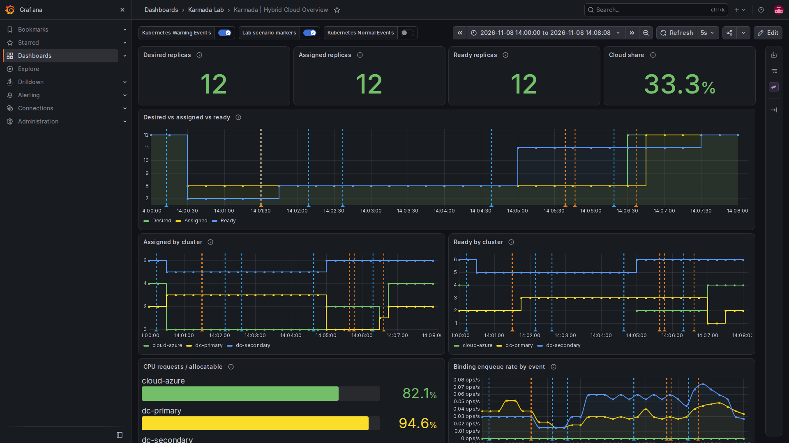

# Scenario C: cluster failover during a primary-cluster outage

**Status: implemented and exercised on the local lab.** The original two demos remain independent. Running `make demo-failover` temporarily changes configuration and pauses `dc-primary` twice; it attempts to restore the captured settings and replica count. See the validation results for observations and limitations. [Magyar változat](02-cluster-failover.hu.md)

## Goal and design

Demonstrate what happens when `dc-primary` becomes unreachable while the demo Deployment has replicas there, and distinguish failure detection from actual recovery. The experiment uses a **real, temporary Docker pause** of the lab-owned `dc-primary-control-plane` container. It keeps the desired count fixed at **8**, with no FederatedHPA or load generators; any replacement is therefore caused by failover rather than a changing replica target.

The nominal calibration is 4/6/12 slots for `dc-primary`/`dc-secondary`/`cloud-azure`. A previous eight-replica run placed 3+5+0. If that distribution and the measured remaining capacity still hold, losing the 3 on `dc-primary` would require some overflow to `cloud-azure`. **Neither 3+5+0 nor the final distribution is guaranteed**: check real assignments and capacity before the run. If `dc-secondary` can fit all 8, successful recovery without cloud placement is possible; that run does not prove cloud overflow. Never change capacity or force another scale operation to manufacture a successful failover.

```mermaid
sequenceDiagram
    participant U as User / future runner
    participant P as dc-primary
    participant K as Karmada control plane
    participant S as dc-secondary and cloud-azure
    participant G as Prometheus / Loki / Grafana
    U->>K: Baseline: 8 desired, assigned and Ready
    U->>P: Pause lab-owned kind node
    P--xK: Member API becomes unreachable
    K->>K: Ready changes; NoSchedule, then configured NoExecute
    K->>K: Toleration expires; eviction / rescheduling
    K->>S: Propagate replacement replicas
    S-->>K: Member Deployments report available replicas
    U->>G: Record timeline and markers
    U->>P: Unpause only if this run paused it
    P-->>K: API and Ready recover
    U->>K: Verify cleanup and restore agreed baseline
```

A paused process does not prove the original Pods were terminated. Karmada may be unable to communicate with the source cluster while it is paused. A replacement is a **new** instance; the old instance can potentially still exist after connectivity returns. This experiment does not prove fencing, exactly-once execution, zero downtime, production readiness, persistent-data replication, or end-user traffic failover.

## Findings from the current lab and Karmada v1.19.1

Read-only inspection on 2026-11-08 found all three Karmada members `Ready`, no cluster taints, `dc-primary` running and not paused, and the demo at **12 desired** with assignment 4+6+2. There was no FederatedHPA. This is a snapshot, not the proposed test baseline. The controller-manager deployment showed no explicit failover-related flags; the scheduler explicitly sets `CustomizedClusterResourceModeling=false`. Do not interpret these observations as a test of failover.

The pinned v1.19.1 source has three distinct safeguards relevant to an **automatic** pause-based test:

1. `Failover` defaults to `false`; `karmada-controller-manager` must enable `--feature-gates=Failover=true` while preserving any other gates. The taint manager must also be enabled; its upstream default is true and the effective setting must be checked.
2. The built-in health controller manages `NoSchedule` taints for `Ready=False` / `Unknown`. Since v1.14, it does **not** automatically add the `NoExecute` taint needed for eviction. An explicit `ClusterTaintPolicy` can translate health conditions into a `NoExecute` taint and remove it on recovery. For this experiment it should target **only** `dc-primary`, including both `False` and `Unknown` through `Ready NotIn True`, with a corresponding `Ready In True` removal condition.
3. A `NoExecute` `ClusterTaintPolicy` requires `karmada-webhook --allow-no-execute-taint-policy=true`; actual taint-based eviction additionally requires `karmada-controller-manager --enable-no-execute-taint-eviction=true`. Both default to false in the pinned source. The default purge mode is `Gracefully`; how it behaves while the source API is paused must be measured, including any temporary overlap and cleanup after recovery.

These are global component settings, even though the test policy selects only `dc-primary`. A matching `NoExecute` taint may affect **all non-tolerating Karmada-managed workloads assigned to that cluster**, not just the demo. Before enabling eviction, inventory existing taints, policies and bindings across all members; refuse the run if foreign `NoExecute` taints or incompatible policies make the scope unclear. The Karmada documentation warns that deleting a `ClusterTaintPolicy` does not automatically remove its existing taints. See [Cluster Taint Management](https://karmada.io/docs/userguide/failover/cluster-taint-management/) and [Cluster Failover](https://karmada.io/docs/userguide/failover/cluster-failover/).

### Detection and waiting

The source defaults include a 30-second cluster failure threshold, 5-second monitoring period and 40-second running-cluster monitor grace period. They serve different parts of health processing: do not add them together or treat them as a failover SLA. Inspect effective controller flags, conditions, taint timestamps, and the policy's actual `clusterTolerations` before a run. A `NoExecute` toleration can delay eviction or allow it indefinitely; no fixed five-minute assumption is made here.

**Temporary demo toleration:** a `clusterTolerations` entry on the demo's existing PropagationPolicy for the dedicated test taint, with `effect: NoExecute` and `tolerationSeconds: 120`. It deliberately separates detecting a short interruption from evicting the demo. Confirm that the policy is applied to the Deployment binding and that the test taint is the only relevant `NoExecute` taint. The Service and any other non-tolerating workload may behave differently. This 120-second value is a lab choice, not a measured requirement or production recommendation.

### Temporary policy used by the runner

The runner creates a temporary policy with the following shape; do not apply this example separately. It targets the one lab member, adds the dedicated `NoExecute` taint when `Ready` is not `True`, and removes it when `Ready` is `True`:

```yaml
apiVersion: policy.karmada.io/v1alpha1
kind: ClusterTaintPolicy
metadata:
  name: lab-failover-dc-primary
spec:
  targetClusters:
    clusterNames: [dc-primary]
  addOnConditions:
    - conditionType: Ready
      operator: NotIn
      statusValues: ["True"]
  removeOnConditions:
    - conditionType: Ready
      operator: In
      statusValues: ["True"]
  taints:
    - key: lab.karmada.io/failover
      effect: NoExecute
```

The temporary addition to the **existing demo Deployment** `PropagationPolicy` goes under `spec.placement`, alongside its existing affinities and replica scheduling. Preserve those fields and check for pre-existing tolerations:

```yaml
clusterTolerations:
  - key: lab.karmada.io/failover
    operator: Exists
    effect: NoExecute
    tolerationSeconds: 120
```

This policy does not select a specific workload; any other workload targeting `dc-primary` is subject to its own tolerations. The runner checks for existing ClusterTaintPolicies and foreign target bindings before it proceeds; global settings still have the wider implications described above.

## Execution phases

1. **Preflight and snapshot.** Confirm management and all three members are Ready; `dc-primary-control-plane` is running, not paused, and its full container ID matches `.runtime/kind-owned/dc-primary.id`. If it is already paused or the ownership record differs, stop without touching it. Capture the original central Deployment replica count, FHPA/load-generator states, demo policy, controller/webhook arguments, taints, ClusterTaintPolicies and Karmada bindings privately. Check available resources and WSL headroom. Refuse to overwrite an active HPA/load generator or an unrelated running scenario. The user's current desired count must not be silently reset.
2. **Baseline for the test.** The runner explicitly sets the demo to 8, then waits until desired=assigned=available=8, `dc-primary` has at least one assigned and available replica, and the 120-second test toleration is reflected in the applied placement. Record actual placement, capacity, event and metric availability. Save a restore point for all temporary configuration changes.
3. **Control run.** With failover still disabled and no test `NoExecute` policy, pause `dc-primary` long enough to observe the Ready transition, but use a bounded timeout. Record whether any assignment changes and distinguish missing metrics from zero. Unpause in a `finally`/trap path, wait for recovery, and re-establish the eight-replica baseline. This demonstrates detection versus failover without asserting that a particular delay proves the feature disabled.
4. **Enable the failover mechanism.** Reconcile the controller-manager gate and eviction flag and the webhook flag, preserve all existing arguments, and wait for deployments and Karmada APIs to recover. Apply a uniquely named test `ClusterTaintPolicy` scoped to `dc-primary`, with a dedicated test taint and mutually exclusive add/remove conditions. Verify actual policy, toleration and flags before fault injection. This phase temporarily changes global controller behavior; the runner records and restores the original settings.
5. **Fault and observe.** Capture a timestamp and emit a failover-specific Loki marker, then pause the exact verified lab container. Observe the Karmada Cluster Ready condition and taints, `ResourceBinding.spec.clusters` and eviction-related status, controller/scheduler events, and member Deployment desired/available counts on `dc-secondary` and `cloud-azure`. Record timestamps for pause, Ready transition, NoExecute, eviction decision, reassignment and surviving-member availability. Once eight replicas are available on the surviving members, keep the source paused for a configurable observation window (60 seconds by default) while monitoring availability, then recover it. The paused member's kube-state-metrics can be missing or stale: never count its last sample as currently Ready.
6. **Recover.** In a trap/finally and on timeout or interruption, unpause **only** the container paused by this run, then wait for its Kubernetes API, node and Karmada Cluster Ready. Observe removal of the test taint and reconciliation of any old resources; inspect the source directly after recovery for extra replicas. Check that the healthy members still provide the intended 8 replicas. Record actual move-back behavior; do not require or assume automatic relocation back to `dc-primary`.
7. **Restore and verify.** After the cluster has recovered, stop and remove only resources created by the experiment; verify the test taint is gone before deleting the test policy, and explicitly remove only the experiment-owned taint if it remains. Restore the original demo policy and exact controller/webhook flags, wait for rollouts and verify them. Restore the pre-run replica count only if the captured state can be safely reconciled; do not recreate an HPA or load generator that was not running at preflight. Run baseline health checks and document any incomplete cleanup. `make reset-demo` restores four, so it must not silently replace a user's captured non-four baseline.

## Acceptance and evidence

| Result | Evidence needed |
| --- | --- |
| Preflight | All members Ready, expected workload present, no conflicting writer, owned target container running/unpaused, existing settings captured. |
| Detection | A timestamped `Ready` transition and the expected policy-created `NoExecute` taint, not merely an absent Grafana line. |
| Eviction and scheduling | After the configured toleration, binding/eviction evidence shows the failed cluster is being evacuated and replacement assignments appear on healthy members; desired count remains 8. |
| Service recovery | Direct Kubernetes API checks on the **surviving** members show available replicas totalling 8, consistent with the final healthy-member assignment. Evidence does not rely on cached metrics from the paused cluster. |
| Cloud overflow | Preflight must establish insufficient surviving on-prem CPU capacity; otherwise the runner stops before fault injection. Success requires at least one Ready `cloud-azure` replica. |
| Recovery and cleanup | The paused node is unpaused, all members become Ready, the experiment-owned taint/policy and temporary flags are restored, and actual source/target replicas are checked for leftovers or overlap. Restore the original desired count if safely possible. |
| Observability | Scenario-specific markers and a timestamped JSONL record tie cluster conditions, binding changes and actual member availability together; Grafana annotations and panels are verified visually. |

Capture `t_pause`, `t_not_ready`, `t_noexecute`, `t_eviction`, `t_assigned`, `t_available` and `t_recovered` where observable; report measured elapsed times and scrape intervals, not an assumed RTO. If any value is missing, record it as unavailable. The `Ready by cluster` dashboard uses Deployment `availableReplicas`; during a pause, expired/stale time series do not establish actual Pod termination. FreeLens cluster status and Grafana are useful views, not substitutes for the control-plane and member API evidence.

## Observed run and Grafana

The run on 2026-11-08 started the actual failover pause at 13:02:09 UTC. `Ready=False` and the test `NoExecute` taint were observed by 13:02:36; eight available replicas on the surviving members, including two on `cloud-azure`, were observed at 13:04:38. The deliberate hold ran from 13:04:38 to 13:05:38 UTC. After unpause, the recovered member initially still reported three old available replicas while the healthy members had 6+2; later reconciliation removed the overlap. Final restoration returned the original desired 12 with 2+6+4 available. These are sampled observations for one local run, not an RTO guarantee. The preceding successful run also captured a `Gracefully` eviction task in the JSONL snapshots.



The `Assigned by cluster` chart shows the primary assignment falling to 0 and cloud rising to 2. The `Ready by cluster` chart can retain the primary's **last reported** value while its Alloy is paused: at that point it is stale, not proof those replicas are reachable. In this run the overview's aggregate `Ready` line also briefly showed 11 when the primary reappeared with three old replicas alongside 6+2 replacements. The result was verified directly on the surviving member APIs; Grafana annotations are timeline aids, not fencing or health proof.

## Failure handling and boundaries

- A container already paused before the run belongs to the existing user state: stop; do not automatically unpause it. A future runner must track both the exact container ID and whether **it** successfully paused that container.
- If the process dies so a trap cannot execute, provide a clear manual recovery instruction and inspect the exact current container identity and state before unpausing. Do not delete clusters, volumes or unrelated resources.
- `SIGKILL`, host/WSL failure and Docker failure can defeat a shell cleanup trap. Report incomplete cleanup, including flags, taints and replica counts. A timeout is a failed or inconclusive test, not a pass.
- Never remove foreign taints or restore stale snapshots blindly over user changes. Since deleting a policy can leave its taint, verify ownership and removal while the policy still exists.
- A frozen member can keep running an old workload after recovery. Check for duplicate replicas and remaining Work/eviction tasks; do not claim split-brain prevention.
- A separate controlled `NoExecute` taint test can isolate eviction mechanics before the pause test, but it does **not** test failure detection. A network partition, application-only failure, StatefulSet or real Azure failover is outside this initial scenario.

### Manual recovery if the runner cannot clean up

If the process or host is terminated abruptly, first inspect the private `.runtime/failover/<run>/restore.json` and `snapshots.jsonl`; `paused_by_run` records whether the runner paused the node. Compare its `container_id` with both the ownership record and the current container before taking action:

```bash
cat .runtime/kind-owned/dc-primary.id
docker inspect -f 'id={{.Id}} running={{.State.Running}} paused={{.State.Paused}}' dc-primary-control-plane
```

Only if the IDs match and this run paused the currently paused container, use `docker unpause dc-primary-control-plane`. Then inspect `kubectl --kubeconfig .runtime/karmada/karmada-apiserver.config get clusters,clustertaintpolicies` and the recorded changes. A stale `restore.json` is not permission to overwrite later user edits: compare the current controller/webhook commands, strategies, demo policy and desired replicas before restoring individual settings. If ownership or safe restoration is unclear, leave it in place and investigate; never delete foreign taints or clusters. Run `make verify` only after the members and configuration have recovered.

## Approved design choices

1. Use **8 fixed replicas**, with a disabled-feature control pause followed by the failover pause.
2. Use a **120-second demo-specific NoExecute toleration**, the upstream default **Gracefully** mode, and a 60-second cloud observation window.
3. Temporarily enable global controller/webhook safeguards and restore them afterward, with a `ClusterTaintPolicy` scoped to `dc-primary`. This still has cluster-wide workload implications.
4. Restore the captured pre-test desired count after the experiment instead of always resetting to four.

Run `make demo-failover` from the repository root. Set the observation window with, for example, `FAILOVER_HOLD_SECONDS=120 make demo-failover`. `FAILOVER_PHASE_TIMEOUT` sets the reassignment timeout in seconds (default 480). A fresh, converged secondary CPU summary must indicate that the surviving on-prem member alone cannot fit all eight; otherwise the runner stops before fault injection. A successful failover requires a Ready cloud replica. Evidence is stored privately under `.runtime/failover/`; see [VALIDATION_RESULTS.md](../docs/VALIDATION_RESULTS.md) for actual results. A trap cannot recover from every process or host failure.
